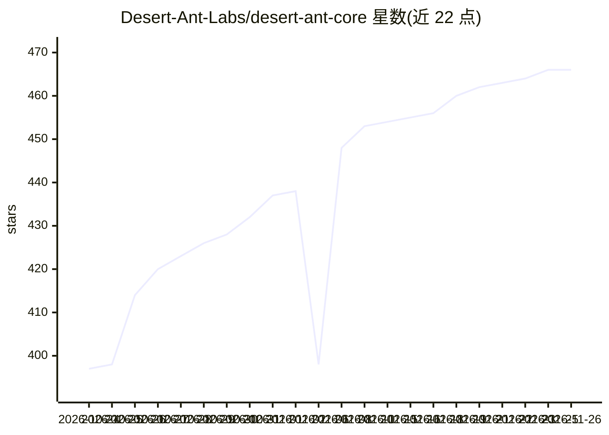

# Desert-Ant-Labs/desert-ant-core

⭐ 466 · Swift · NOASSERTION · 推送 2026-11-25 · [GitHub](https://github.com/Desert-Ant-Labs/desert-ant-core) · [官网](https://desertant.com) · 组织维护

**面向移动/桌面/Web 开发者的离线端侧 AI 模型 SDK 套件**

提供 Swift、Kotlin、JavaScript/TypeScript SDK 与 CLI，集成 18 个端侧模型（语音识别、降噪、PII 脱敏、表情符号建议、人脸匹配、NSFW 检测、说话人分离等），全部在设备本地推理，数据不离开设备。模型权重公开在 Hugging Face，SDK 首次使用时按固定版本下载并校验。Apple 平台需 iOS 18+/macOS 15+ 且依赖 Core ML，Android 需 API 24+ 并共享 LiteRT，浏览器端经 WebAssembly/LiteRT.js 运行。许可证为 source-available，大规模商用需购买商业许可。

## 筛选速览

| 维度 | 判定 | 备注 |
|---|---|---|
| AI 角色 | `ai-native` | 本体是模型或模型工具 |
| 许可风险 | `none` | NOASSERTION |
| 部署形态 | `library` | 以包/库形式分发 |
| 模型依赖 | — | README 未给出锁定关系 |
| 硬件要求 | — | 无带数字的原话,不猜 |
| 安装摩擦 | `low` | 无编译、无系统依赖或容器化 |
| 成熟度 | — | 结构信号不足 |

## 能力要点

- 18 个端侧模型覆盖语音识别、脱敏、人脸匹配、内容审核等任务，全部离线推理
- Swift/Kotlin/JavaScript 三语言 SDK，按模型拆分按需引入
- 模型权重公开于 Hugging Face，SDK 固定版本并校验下载
- 配套 CLI 支持 macOS (Apple silicon) 与 Linux，命令间以 JSON 串联

## 适用场景

- 在 App 内实现本地语音转写与 PII 脱敏，数据不出设备
- 在浏览器中离线运行图像理解或内容审核模型
- 用 CLI 终端转写录音、切剪辑片段、清理音频

## 场景标签

`语音识别` `人脸识别` · 领域:感知与多模态

## 证据(README 行号)

> L9: Add on-device speech recognition, audio cleanup, PII redaction, emoji suggestion, and more to your app, with SDKs fo
> L41: |**Voz**|On-device speech recognition: transcripts with word-level timestamps, 25 languages.|Apple · Android · Linu
> L57: On Apple platforms, the Swift package requires iOS 18+, macOS 15+, tvOS 18+, visionOS 2+, and Swift 6.2+ (Xcode 26)

## 星数曲线

2026-10-24 397 → 2026-11-26 466（+69）

---
*卡片 v1 · prompt 1.4 · 生成 2026-11-25 · 置信度 high · 依据 README sha `4230e2022839` · [字段定义](../../DATASET.md)*
