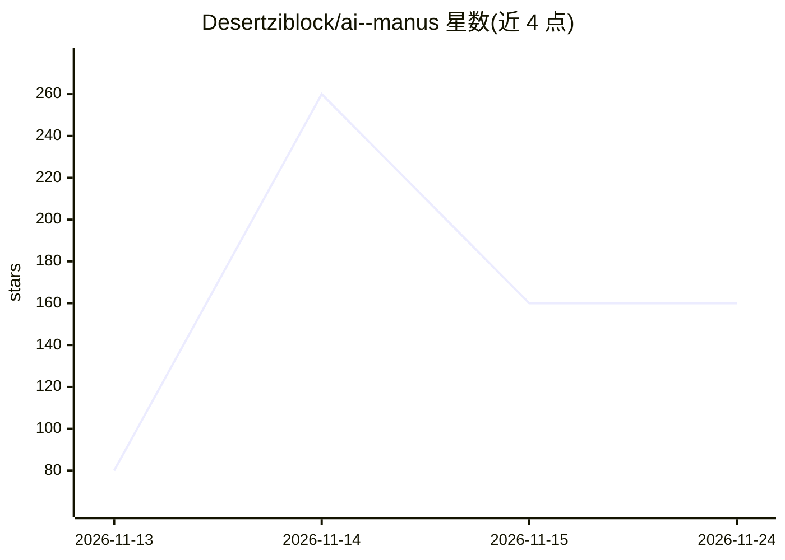

# Desertziblock/ai--manus

⭐ 160 · Apache-2.0 · 推送 2026-11-15 · [GitHub](https://github.com/Desertziblock/ai--manus) · 个人维护

**面向日常任务的自主 AI 代理：自动执行代码与浏览器操作**

自称 Manus 的自主 AI 代理，宣称可代替用户编写并执行脚本、控制浏览器完成导航、填表、信息收集等多步骤任务，定位为家庭、学习与轻量办公的个人助理，而非企业平台。README 仅含功能宣传、系统兼容表（4GB 内存起步、建议 8GB）与使用流程说明，未提供任何安装命令、代码入口或 API 接入方式，也未说明所用的模型来源。内容以 SEO 式关键词罗列为主，技术细节缺失，实际可用性无法从 README 验证。

## 筛选速览

| 维度 | 判定 | 备注 |
|---|---|---|
| AI 角色 | `ai-native` | 本体是模型或模型工具 |
| 许可风险 | `permissive` | Apache-2.0 |
| 部署形态 | `None` |  |
| 模型依赖 | — | README 未给出锁定关系 |
| 硬件要求 | — | 无带数字的原话,不猜 |
| 安装摩擦 | `low` | 无编译、无系统依赖或容器化 |
| 成熟度 | — | 结构信号不足 |

## 能力要点

- 宣称支持自主代码执行与浏览器控制
- 宣称支持跨会话的多步骤任务与模式记忆
- 提供系统兼容性要求表（最低 4GB RAM，建议 8GB）

## 适用场景

- 让代理自动完成网页查信息、填表等重复操作
- 学生组织研究笔记、跑小脚本
- 轻量办公中汇总多页信息生成摘要

## 场景标签

`AI 助手` `浏览器自动化` `编码 Agent` · 领域:效率与自动化

## 证据(README 行号)

> L10: - **Autonomous Code Execution:** Manus AI agent runs code on its own to complete tasks, so you can focus on decisio
> L18: Manus is an autonomous AI agent designed to run code and control a browser on your behalf. Instead of acting like a

## 星数曲线

2026-11-13 80 → 2026-11-24 160（+80）

---
*卡片 v1 · prompt 1.4 · 生成 2026-11-17 · 置信度 low · 依据 README sha `0f78ee3a5dd2` · [字段定义](../../DATASET.md)*
