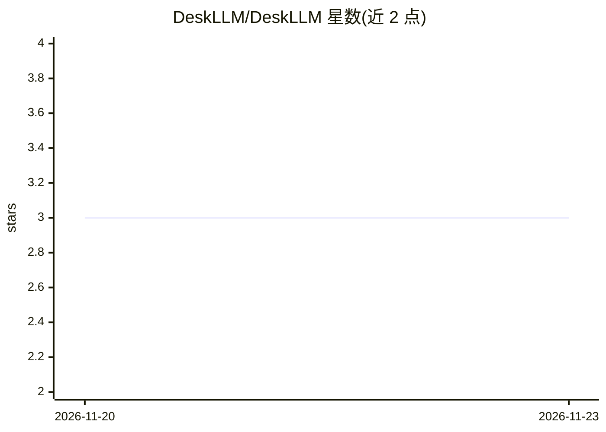

# DeskLLM/DeskLLM

⭐ 3 · Python · GPL-3.0 · 推送 2026-11-15 · [GitHub](https://github.com/DeskLLM/DeskLLM) · 个人维护

**给普通用户在本地电脑运行大模型对话的 Windows 桌面应用**

面向不想碰终端命令、Python 或 API 密钥的 Windows 用户：安装包内置 Python 与 Vulkan 引擎，应用按用户显卡/内存/CPU 推荐模型，从 Hugging Face 一键下载后可完全离线对话。功能覆盖模型库（200+ 模型、GGUF 直开、Ollama 连接）、流式聊天、文档/图片对话、离线土耳其语和英语语音输入、GPU/CPU 自动部署与资源监控。仅有 Windows 版本，处于 0.9 Beta 阶段，单人维护项目。

## 筛选速览

| 维度 | 判定 | 备注 |
|---|---|---|
| AI 角色 | `ai-native` | 本体是模型或模型工具 |
| 许可风险 | `viral` | GPL-3.0 |
| 部署形态 | `desktop` | 安装包/桌面程序 |
| 模型依赖 | local-ok | 支持本地模型 |
| 硬件要求 | — | 无带数字的原话,不猜 |
| 安装摩擦 | `medium` | 含编译或系统依赖之一 |
| 成熟度 | `idea` | |

## 能力要点

- 按硬件推荐模型并一键下载，支持断点续传与 .gguf 直开
- 离线对话与离线土耳其语/英语语音输入
- CUDA/Vulkan/CPU 三级自动回退的模型部署
- 文档问答可显示答案依据的文档段落

## 适用场景

- 不想注册账号订阅服务，在自己的电脑上跑大模型聊天
- 断网或隐私敏感环境下与本地模型对话
- 用文档问答并查看答案出处

## 场景标签

`聊天机器人` `文档问答` `推理引擎` · 领域:对话与助手

## 证据(README 行号)

> L11: DeskLLM, yerel yapay zekâ modelleriyle sohbet etmeni sağlayan bir masaüstü uygulamasıdır. Bilgisayarının donanımına
> L13: Terminal komutlarıyla uğraşmana, Python kurmana ya da API anahtarı almana gerek yok. Kurulum dosyasını çalıştır, mo

## 星数曲线

2026-11-20 3 → 2026-11-23 3（+0）

---
*卡片 v1 · prompt 1.4 · 生成 2026-11-22 · 置信度 mid · 依据 README sha `b48efbc787ec` · [字段定义](../../DATASET.md)*
