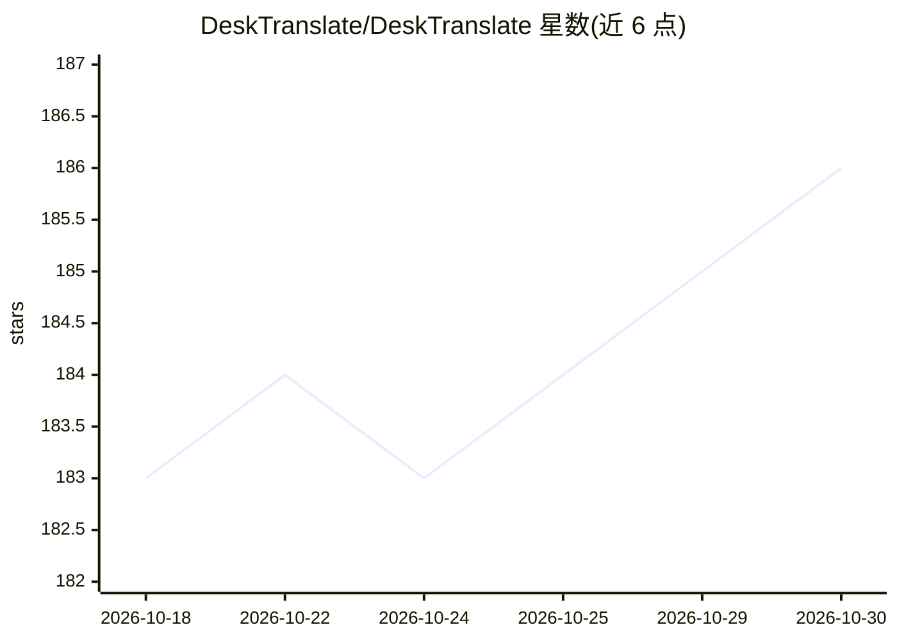

# DeskTranslate/DeskTranslate

⭐ 186 · Python · MIT · 推送 2026-10-22 · [GitHub](https://github.com/DeskTranslate/DeskTranslate) · [官网](https://github.com/DeskTranslate/DeskTranslate#readme) · 组织维护

**Windows 屏幕取词翻译工具：划区 OCR 并本地/云端翻译**

面向 Windows 用户的屏幕翻译桌面应用：快捷键选取屏幕区域，经本地 RapidOCR/ONNX 识别（可选 Tesseract），再通过所选翻译提供方输出到可自定义的悬浮字幕层。支持单次截取与持续对话跟踪、绑定窗口字幕区域、按游戏/剧集保存配置档案。翻译提供方覆盖 Google 免密快译、DeepL、LibreTranslate、OpenAI、Claude、Gemini、OpenRouter、Ollama、LM Studio 及 OpenAI 兼容端点；OCR 与翻译引擎相互独立。截图仅存于内存，API key 存于系统凭据库。安装包面向 Windows 10 build19041 及以上，二进制当前未签名。

## 筛选速览

| 维度 | 判定 | 备注 |
|---|---|---|
| AI 角色 | `ai-native` | 本体是模型或模型工具 |
| 许可风险 | `permissive` | MIT |
| 部署形态 | `desktop` | 安装包/桌面程序 |
| 模型依赖 | local-ok | 支持本地模型 |
| 硬件要求 | — | 无带数字的原话,不猜 |
| 安装摩擦 | `low` | 无编译、无系统依赖或容器化 |
| 成熟度 | — | 结构信号不足 |

## 能力要点

- 本地管理的 RapidOCR/ONNX 识别模型，支持日/韩/中/英/西语
- 十种翻译提供方：免密 Google、DeepL、LibreTranslate 及本地 Ollama/LM Studio 等
- 可编辑字幕式悬浮层：字体、颜色、轮廓、点击穿透、行数限制
- 按游戏/剧集保存含语言、引擎、术语表、上下文的配置档案

## 适用场景

- 玩日文/韩文游戏时实时翻译对话框与字幕
- 观看无字幕视频时跟随字幕区域持续翻译
- 翻译图片、菜单等屏幕上的静态文本

## 场景标签

`OCR` · 领域:感知与多模态

## 证据(README 行号)

> L19: - **Recognition runs locally.** Managed, verified RapidOCR/ONNX models replace executable-path setup. Optional Tess
> L94: |Ollama|Local, contextual AI|Start Ollama and install a model yourself|

## 星数曲线

2026-10-18 183 → 2026-10-30 186（+3）

---
*卡片 v1 · prompt 1.4 · 生成 2026-10-22 · 置信度 mid · 依据 README sha `08b7f6eaba23` · [字段定义](../../DATASET.md)*
