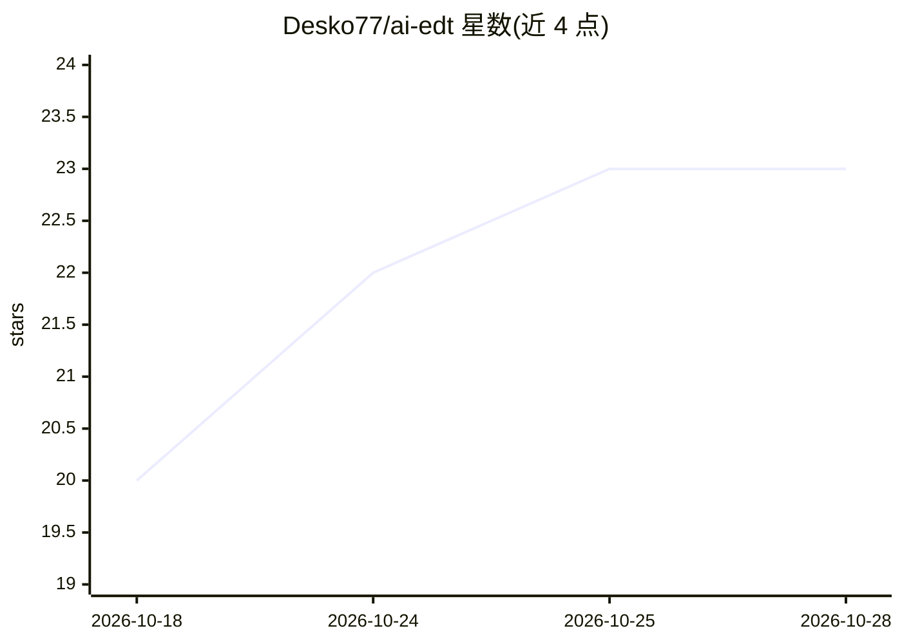

# Desko77/ai-edt

⭐ 23 · Java · AGPL-3.0 · 推送 2026-10-25 · [GitHub](https://github.com/Desko77/ai-edt) · [官网](https://desko77.github.io/ai-edt/) · 个人维护

**1C:EDT 内运行的 MCP 服务器，让 AI 代理语义化访问 1C 项目**

以 Eclipse 插件形式嵌入运行中 1C:EDT 实例的 MCP 服务器：Claude、Cursor、GitHub Copilot 等 MCP 客户端通过它读取与修改 BSL 代码和元数据、解析语义链接、调用 EDT 自带校验器、管理调试会话并操作连接的信息库。核心机制是复用 EDT 的语义模型、索引与调试服务，而非把工作区当 XML/BSL 文件目录。当前版本要求 1C:EDT 2026.2 或 2026.1，通过 EDT 更新站点或 release 的 zip 归档安装；构建脚本仅针对 Windows 描述。

## 筛选速览

| 维度 | 判定 | 备注 |
|---|---|---|
| AI 角色 | `ai-ecosystem` | LLM/agent 周边工具 |
| 许可风险 | `viral` | AGPL-3.0 |
| 部署形态 | `desktop` | 安装包/桌面程序 |
| 模型依赖 | — | README 未给出锁定关系 |
| 硬件要求 | — | 无带数字的原话,不猜 |
| 安装摩擦 | `low` | 无编译、无系统依赖或容器化 |
| 成熟度 | — | 结构信号不足 |

## 能力要点

- MCP 工具覆盖元数据创建/编辑、BSL 调试、依赖图、配置校验与更新
- 复用 EDT 语义模型、索引与校验器，AI 改动即时验证
- 支持信息库管理：快照导出/回载、增量更新、数据丢失预警
- 提供调用历史查看与多 EDT 实例识别

## 适用场景

- 让 AI 代理在 1C:EDT 内做代码导航、元数据修改与调试
- 用 EDT 校验器即时检查 AI 生成的 BSL 与配置对象
- 通过 AI 完成配置更新、扩展导入与信息库同步等运维操作

## 场景标签

`编码 Agent` · 领域:编码与开发

## 证据(README 行号)

> L19: AI-EDT - MCP-сервер в виде плагина, работающего **внутри запущенного экземпляра 1C:EDT**. Он позволяет Claude, Curs
> L21: Вместо того чтобы воспринимать рабочее пространство EDT как каталог XML- и BSL-файлов, ассистент использует семанти
> L24: > Текущая версия работает на **1C:EDT 2026.2** и **2026.1**. Сборка идет против 2026.1, поэтому один артефакт стави

## 星数曲线

2026-10-18 20 → 2026-10-28 23（+3）

---
*卡片 v1 · prompt 1.4 · 生成 2026-10-27 · 置信度 high · 依据 README sha `9cb875d96125` · [字段定义](../../DATASET.md)*
