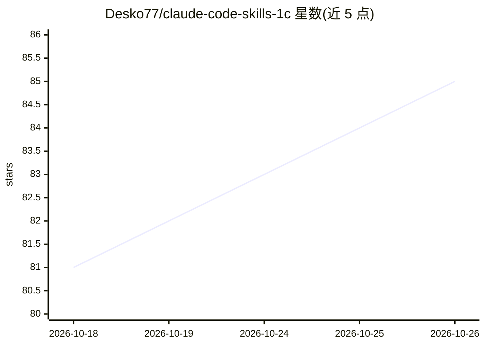

# Desko77/claude-code-skills-1c

⭐ 85 · Python · MIT · 推送 2026-10-25 · [GitHub](https://github.com/Desko77/claude-code-skills-1c) · 个人维护 · 中文 README

**给 Claude Code 的 1С 开发技能包：121 技能+40 规则，无 Configurator 操作源码**

面向把 1С 源码置于 git 管理的开发者：为 Claude Code 提供 121 个技能、40 条规则与 1 个子代理，让 agent 以平台格式（XML dump）直接编译/反编译元数据对象、表单、角色、СКД、扩展与外部处理，基础操作无需运行 1С 平台或 Configurator。内置 14 个验证器与配置索引校验名称与结构（不含表达式类型与 BSL 语义）。附带 БСП（2624 方法）、ЗУП 等 API 参考与调用前校验，可与 AI-EDT 插件（MCP 服务器）组合获得 EDT 语义模型。分层设计：基础 XML 生成无平台依赖，高级技能需 1С 或 MCP。

## 筛选速览

| 维度 | 判定 | 备注 |
|---|---|---|
| AI 角色 | `ai-ecosystem` | LLM/agent 周边工具 |
| 许可风险 | `permissive` | MIT |
| 部署形态 | `None` |  |
| 模型依赖 | — | README 未给出锁定关系 |
| 硬件要求 | — | 无带数字的原话,不猜 |
| 安装摩擦 | `medium` | 含编译或系统依赖之一 |
| 成熟度 | — | 结构信号不足 |

## 能力要点

- 从紧凑 JSON 编译元数据/表单/角色/СКД/扩展并反向解析，无需 Configurator
- 14 个验证器 + 1c-config-index 与其余配置交叉校验（引用类型、表单数据路径、角色权限等）
- БСП API 参考：2624 方法/284 模块，check 命令拒绝库中不存在的调用
- 可选 AI-EDT MCP 插件在 1C:EDT 内提供 100+ 语义操作（调试、诊断、元数据编辑）

## 适用场景

- 让 agent 生成 1С 配置对象与表单并自动通过结构校验
- 在不动支持锁的前提下通过扩展（cfe）改造典型配置
- 反编译他人的 .epf 处理以理解其功能
- 重构后用配置索引查找断链（类型、路径、权限）

## 场景标签

`代码生成` `编码 Agent` · 领域:编码与开发

## 证据(README 行号)

> L3: Набор скилов, правил и команд для Claude Code:
> L11: Скилы дают агенту готовые операции над исходниками: собрать объект метаданных, форму, роль, схему
> L27: Кому пригодится: разработчику 1С, который держит исходники под git и готов отдать агенту рутину -

## 星数曲线

2026-10-18 81 → 2026-10-26 85（+4）

---
*卡片 v1 · prompt 1.4 · 生成 2026-10-24 · 置信度 high · 依据 README sha `623647081e9f` · [字段定义](../../DATASET.md)*
