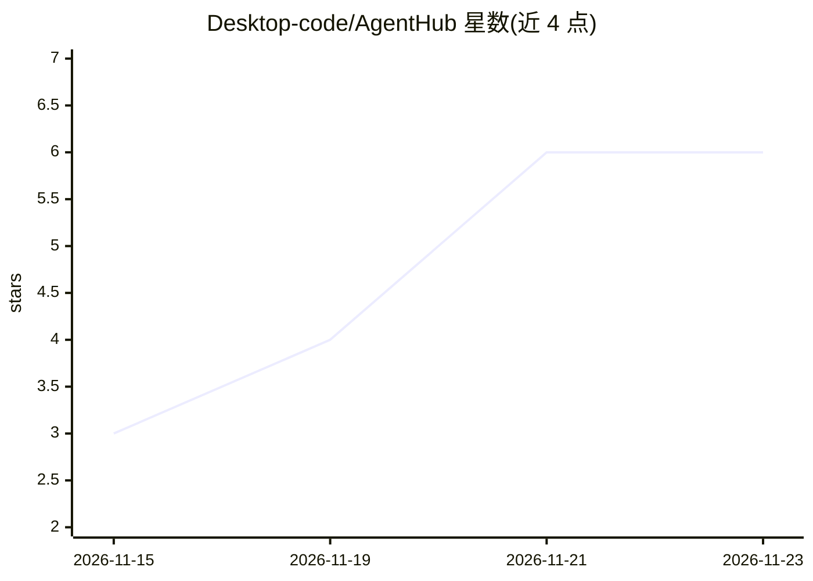

# Desktop-code/AgentHub

⭐ 6 · Java · MIT · 推送 2026-11-22 · [GitHub](https://github.com/Desktop-code/AgentHub) · 个人维护 · 中文 README

**给企业用的可独立部署 Agent 中台：配置编排、统一对话入口**

基于 Spring Boot 3 与 Vue 3 的可独立部署 Agent 中台：通过配置将模型、工具、知识库、提示词、记忆、技能组装为可运行的 Agent，提供统一对话入口、多智能体分发、可视化工作流画布（草稿与发布版本分离）、模型管理（供应商→凭证→实例）与链路追踪（每次提问生成含判定、分发、工具与模型调用的 span）。Agent 引擎为 AgentScope-Java，支持 ReAct 与 Plan-Execute。支持 Docker Compose 一键部署或本机 jar 运行。

## 筛选速览

| 维度 | 判定 | 备注 |
|---|---|---|
| AI 角色 | `ai-ecosystem` | LLM/agent 周边工具 |
| 许可风险 | `permissive` | MIT |
| 部署形态 | `self-host` | docker 或自建部署 |
| 模型依赖 | — | README 未给出锁定关系 |
| 硬件要求 | — | 无带数字的原话,不猜 |
| 安装摩擦 | `low` | 无编译、无系统依赖或容器化 |
| 成熟度 | — | 结构信号不足 |

## 能力要点

- 配置式组装模型、工具、知识库、提示词、记忆、技能为 Agent
- 可视化工作流画布，草稿与不可变发布版本分离
- 一次提问一条全链路追踪，判定/分发/工具/模型调用各占一个 span
- Docker Compose 一键拉起依赖与前后端，或打成单 jar 运行

## 适用场景

- 企业内统一部署和管理多个 Agent 应用
- 用可视化画布编排方案与工作流并发布版本
- 排查 Agent 问答链路中的分发、工具与模型调用问题
- 集中管理多家模型供应商的凭证与实例绑定

## 场景标签

`多智能体` `RAG` `Agent 框架` · 领域:Agent 开发

## 证据(README 行号)

> L3: **可独立部署的企业 Agent 中台。** 用配置把模型、工具、知识库、提示词、记忆、技能装成可运行的 Agent，再用统一的「对话」入口和运行、观测把它们用起来。
> L19: |Agent 引擎|AgentScope-Java 2.0.4：ReAct、Plan-Execute 与分发执行|
> L46: 本机 / 单机推荐 **Docker Compose 一键**拉起 MySQL、Redis、Milvus 链路、后端与前端。需要本机已安装 Docker（含 Compose 插件）。

## 星数曲线

2026-11-15 3 → 2026-11-23 6（+3）

---
*卡片 v1 · prompt 1.4 · 生成 2026-11-21 · 置信度 high · 依据 README sha `c123b171a11d` · [字段定义](../../DATASET.md)*
