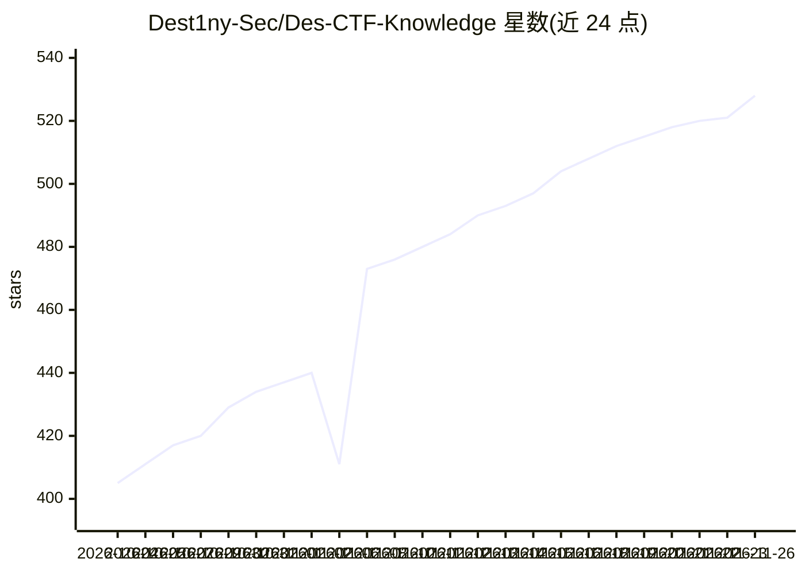

# Dest1ny-Sec/Des-CTF-Knowledge

⭐ 528 · Python · NOASSERTION · 推送 2026-11-12 · [GitHub](https://github.com/Dest1ny-Sec/Des-CTF-Knowledge) · 个人维护 · 中文 README

**CTF 选手的解题知识库：WP/技法/Payload 检索与 RAG 语料**

面向 CTF 选手与 AI Agent 的解题参考知识库，收录 1049 篇历年大赛 WP、67 张技法卡片、12 篇 Web/Misc 专题笔记、110 个解题脚本与 Payload 速查，全部为 Markdown 纯文本，可直接阅读或 git clone 后用 ripgrep 检索。提供 MCP Server（stdio）供 Agent 调用检索工具，并可导出带质量标记的 RAG 语料。README 明示已知限制：WP 图片被移除、约 57% 代码块换行压平、派生内容未全部人工核验。

## 筛选速览

| 维度 | 判定 | 备注 |
|---|---|---|
| AI 角色 | `ai-knowledge` | 知识聚合/清单类 |
| 许可风险 | `none` | NOASSERTION |
| 部署形态 | `library` | 以包/库形式分发 |
| 模型依赖 | — | README 未给出锁定关系 |
| 硬件要求 | — | 无带数字的原话,不猜 |
| 安装摩擦 | `low` | 无编译、无系统依赖或容器化 |
| 成熟度 | — | 结构信号不足 |

## 能力要点

- 1049 篇大赛 WP、67 张技法卡片、12 篇专题与 110 个脚本，全 Markdown 纯文本
- MCP Server 提供检索工具（find_technique/search/find_wp/get_payload 等）
- 可导出带质量标记的 RAG 语料，并配套索引重建与健康检查工具
- 每篇专题配 .idx.md 章节索引，支持按标题与行号定位

## 适用场景

- 做题卡住时按题目现象检索解题技法与适用条件
- 把知识库接入 RAG 或 MCP 客户端供 Agent 查阅
- 沿专题笔记与靶场 WP 系统学习 Web/Misc 方向

## 场景标签

`知识库管理` `网络安全` · 领域:知识与检索

## 证据(README 行号)

> L1: Des-CTF-Knowledge：CTF 解题参考知识库，1049 篇 WP、67 张技法卡片、12 篇专题笔记。
> L9: 面向 CTF 选手与 AI Agent 的解题参考知识库，收录历年比赛 WriteUp、漏洞专题笔记、解题方法和常用脚本，支持按知识点、题目特征和比赛信息检索。
> L102: ## AI Agent 接入

## 星数曲线

2026-10-24 405 → 2026-11-26 528（+123）

---
*卡片 v1 · prompt 1.4 · 生成 2026-11-25 · 置信度 high · 依据 README sha `a5e4de38198d` · [字段定义](../../DATASET.md)*
