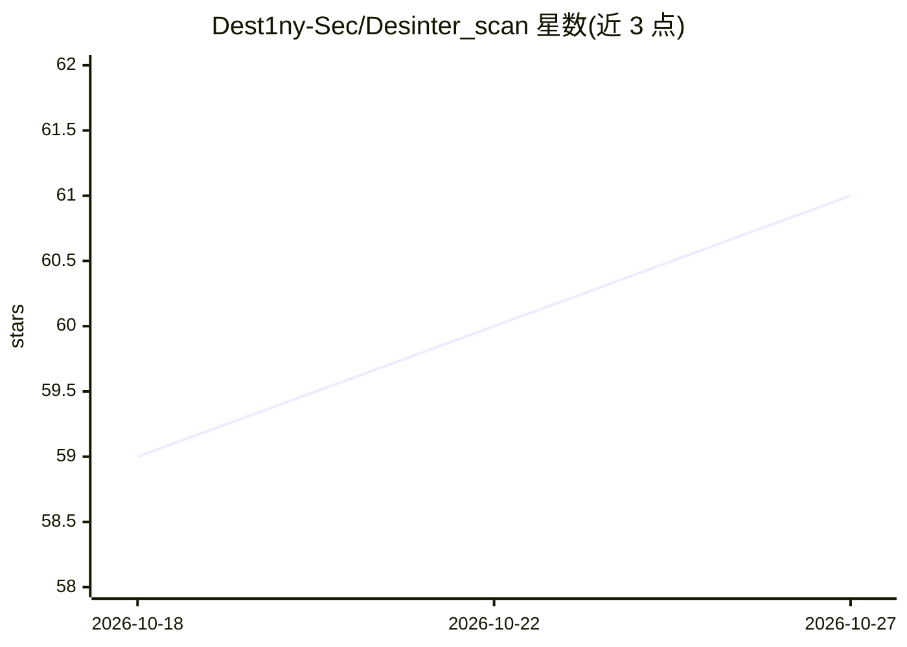

# Dest1ny-Sec/Desinter_scan

⭐ 61 · Python · MIT · 推送 2026-08-19 · [GitHub](https://github.com/Dest1ny-Sec/Desinter_scan) · 个人维护 · 中文 README

**面向授权渗透测试的多 Agent 侦察扫描与 AI 评分系统**

多阶段并发的资产侦察工具：将资产发现、服务探测、深度扫描三阶段流水线化，含 23 个 collector（子域名、端口扫描、目录爆破、源码泄露、GitHub 泄露、Nuclei CVE 扫描等，README 主题行称 22 个），扫描中实时标记未授权 Redis/Docker/S3 等告警。扫描完成后由 Claude AI 按 6 个加权维度评分，输出五层攻击优先级报告，并可导出 HTML/CSV。外部工具（nuclei/nmap 等）为可选依赖，缺失时自动跳过对应 collector；不填 API Key 也可用免费数据源运行。README 声明仅供授权测试使用。

## 筛选速览

| 维度 | 判定 | 备注 |
|---|---|---|
| AI 角色 | `ai-enhanced` | 去掉 AI 部分产品仍成立 |
| 许可风险 | `permissive` | MIT |
| 部署形态 | `library` | 以包/库形式分发 |
| 模型依赖 | locked-api |  |
| 硬件要求 | — | 无带数字的原话,不猜 |
| 安装摩擦 | `low` | 无编译、无系统依赖或容器化 |
| 成熟度 | — | 结构信号不足 |

## 能力要点

- 23 个 collector 分四阶段流水线化并发扫描
- Claude 按 6 个加权维度评分并输出五层攻击优先级报告
- 扫描中实时标记未授权服务与密钥泄露告警
- 缺少外部工具时自动跳过对应 collector，不中断流程

## 适用场景

- 授权渗透测试前对目标资产做攻击面侦察
- 对扫描结果做价值评估并获取攻击优先级排序
- 持续监控资产的泄露与未授权服务暴露

## 场景标签

`多智能体` `网络安全` · 领域:Agent 开发

## 证据(README 行号)

> L23: **inter_scan** 是一个多 Agent 并发信息收集系统，将资产发现、服务探测、深度扫描三阶段流水线化，扫描完成后由 Claude AI 自动进行多维度价值评估，输出按攻击优先级排序的资产列表。
> L139: 扫描完成后 Claude 按以下维度评分：
> L162: 复制 `config.yaml` 填入 API Key（不填也能跑，用免费数据源）：

## 星数曲线

2026-10-18 59 → 2026-10-27 61（+2）

---
*卡片 v1 · prompt 1.4 · 生成 2026-10-24 · 置信度 mid · 依据 README sha `0da1c27575fb` · [字段定义](../../DATASET.md)*
