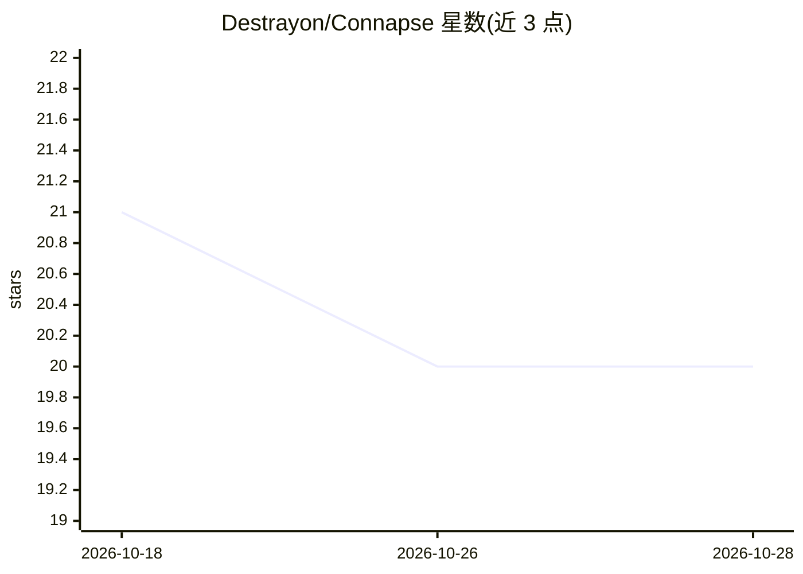

# Destrayon/Connapse

⭐ 20 · C# · MIT · 推送 2026-10-27 · [GitHub](https://github.com/Destrayon/Connapse) · 个人维护

**给 AI agent 用的自托管知识后端：持久记忆+混合检索**

开源自托管知识后端（.NET 10），为 AI agent 提供跨会话的持久可检索记忆：上传 PDF/Office/Markdown 等文档或挂接现有 S3/本地文件系统，经解析、分块、嵌入后支持向量+关键词混合检索（凸组合/DBSF/AutoCut 融合）。agent 可通过 11 个 MCP 工具、REST API、CLI 或 Web UI 访问。嵌入与 LLM 可在 Ollama、OpenAI、Azure OpenAI、Anthropic 间运行时切换。提供多级 RBAC、审计日志与速率限制；项目处于 v0.3.x 活跃开发期，pre-1.0。

## 筛选速览

| 维度 | 判定 | 备注 |
|---|---|---|
| AI 角色 | `ai-ecosystem` | LLM/agent 周边工具 |
| 许可风险 | `permissive` | MIT |
| 部署形态 | `self-host` | docker 或自建部署 |
| 模型依赖 | local-ok | 支持本地模型 |
| 硬件要求 | — | 无带数字的原话,不猜 |
| 安装摩擦 | `low` | 无编译、无系统依赖或容器化 |
| 成熟度 | `idea` | |

## 能力要点

- 混合检索：向量+关键词，可配置融合策略（凸组合/DBSF/AutoCut）
- 11 个 MCP 工具供 agent 查询与构建知识库
- 运行时切换嵌入/LLM 提供商（Ollama/OpenAI/Azure/Anthropic），无需重启
- 容器级项目隔离 + 多级 RBAC + 审计日志

## 适用场景

- 让我的 AI agent 跨会话记住并检索研究资料
- 把现有 S3/本地文件接入为可检索的知识源
- 团队搭建项目隔离、带权限与审计的知识后端

## 场景标签

`知识库管理` `RAG` `Agent 记忆` · 领域:Agent 开发

## 证据(README 行号)

> L19: Every time you start a new conversation, your AI agent starts from zero — no memory of past research, no access to 
> L173: - **🤖 4 Access Surfaces** — Web UI, REST API, CLI (native binaries), and MCP server for Claude. Built for humans, 

## 星数曲线

2026-10-18 21 → 2026-10-28 20（-1）

---
*卡片 v1 · prompt 1.4 · 生成 2026-10-28 · 置信度 high · 依据 README sha `5ee48094d2d8` · [字段定义](../../DATASET.md)*
