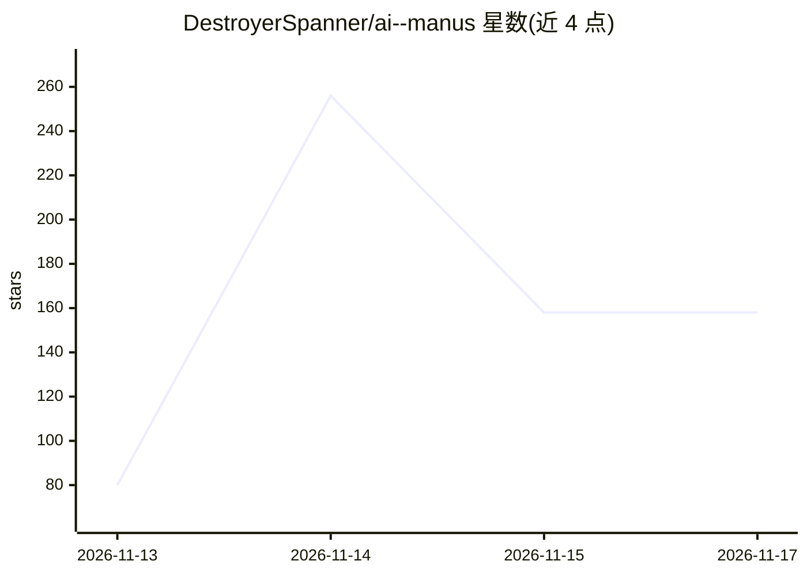

# DestroyerSpanner/ai--manus

⭐ 158 · Apache-2.0 · 推送 2026-11-15 · [GitHub](https://github.com/DestroyerSpanner/ai--manus) · 个人维护

**面向日常任务的自主 AI Agent：自动执行代码与浏览器操作**

README 描述一个自主执行任务的 AI Agent：可自行编写并运行脚本、控制浏览器（导航网页、填表、采集信息），并以多步骤、低监督方式完成日常小任务，面向家庭、学习与轻量办公场景的用户。仓库描述补充其在沙箱环境中运行多种工具与操作。README 未给出任何安装命令、源码结构或模型接入说明，仅含功能介绍、兼容性配置表与使用步骤；README 中重复出现推广字样与下载关键词，可验证的技术事实有限。

## 筛选速览

| 维度 | 判定 | 备注 |
|---|---|---|
| AI 角色 | `ai-native` | 本体是模型或模型工具 |
| 许可风险 | `permissive` | Apache-2.0 |
| 部署形态 | `None` |  |
| 模型依赖 | — | README 未给出锁定关系 |
| 硬件要求 | — | 无带数字的原话,不猜 |
| 安装摩擦 | `low` | 无编译、无系统依赖或容器化 |
| 成熟度 | — | 结构信号不足 |

## 能力要点

- 自主编写并执行代码以完成任务
- 浏览器控制：导航、填表、信息采集
- 多步骤任务可在脚本与浏览器之间衔接执行
- 跨会话记住并复用工作流模式（README 自述）

## 适用场景

- 让学生收集资料、跑小脚本并整理笔记
- 让 agent 代为填表、查网页、整理文件等重复性事务
- 轻量办公中汇总多页面信息准备简报

## 场景标签

`浏览器自动化` `编码 Agent` `AI 助手` · 领域:效率与自动化

## 证据(README 行号)

> L10: - **Autonomous Code Execution:** Manus AI agent runs code on its own to complete tasks, so you can focus on decisio
> L18: Manus is an autonomous AI agent designed to run code and control a browser on your behalf. Instead of acting like a

## 星数曲线

2026-11-13 80 → 2026-11-17 158（+78）

---
*卡片 v1 · prompt 1.4 · 生成 2026-11-17 · 置信度 low · 依据 README sha `0f78ee3a5dd2` · [字段定义](../../DATASET.md)*
