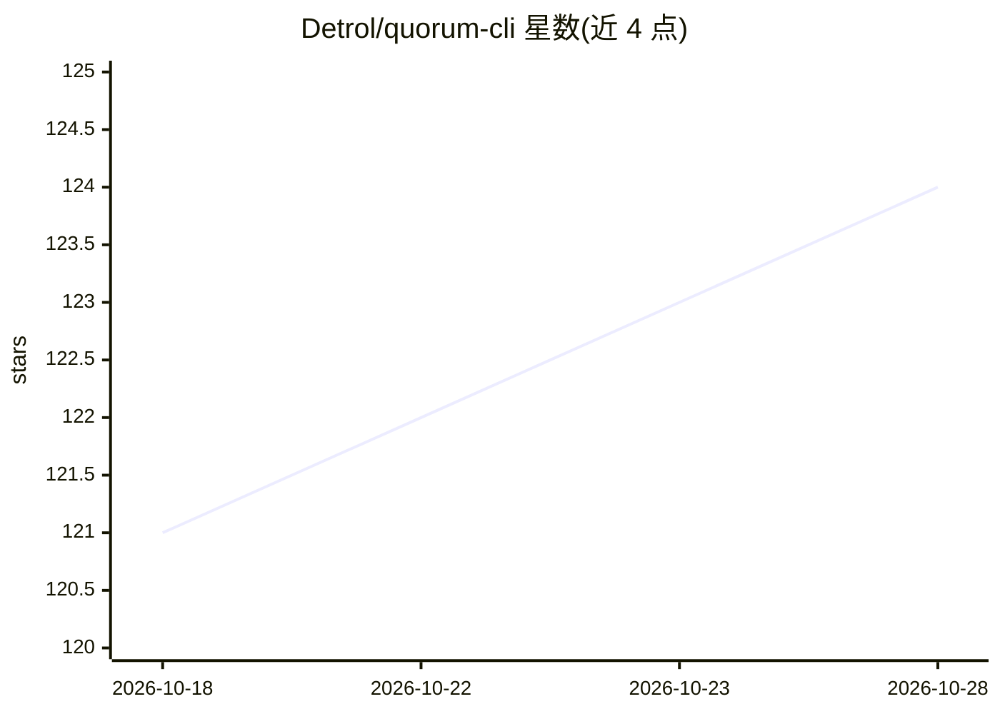

# Detrol/quorum-cli

⭐ 124 · Python · NOASSERTION · 推送 2026-09-27 · [GitHub](https://github.com/Detrol/quorum-cli) · 个人维护

**让多个 LLM 在终端进行结构化辩论的多智能体 CLI**

Quorum 是终端多智能体 AI 讨论系统：向多个模型（Claude、GPT、Gemini、Grok，以及通过 Ollama 的本地模型）提问，让它们按七种讨论方法（Standard、Oxford、Advocate、Socratic、Delphi、Brainstorm 等）辩论、头脑风暴或审议，最终产出综合结论。支持 OpenAI 兼容端点（OpenRouter、LM Studio、llama-swap、vLLM、自定义端点），可让 Agent CLI（claude、codex、agy、grok）与 API 模型同场讨论；另提供 Claude Code 与 Codex 的 MCP 插件形式，可读取项目文件（只读）。以 pip 安装，需 Python 3.11+ 与 Node.js 18+，API key 经 ~/.quorum/.env 配置，至少需配置一个 provider。

## 筛选速览

| 维度 | 判定 | 备注 |
|---|---|---|
| AI 角色 | `ai-native` | 本体是模型或模型工具 |
| 许可风险 | `none` | NOASSERTION |
| 部署形态 | `library` | 以包/库形式分发 |
| 模型依赖 | local-ok | 支持本地模型 |
| 硬件要求 | — | 无带数字的原话,不猜 |
| 安装摩擦 | `low` | 无编译、无系统依赖或容器化 |
| 成熟度 | — | 结构信号不足 |

## 能力要点

- 七种讨论方法（Standard/Oxford/Advocate/Socratic/Delphi/Brainstorm 等），各有参与模型数量要求
- 多 Provider 接入：OpenAI/Anthropic/Google/xAI 原生 + Ollama 本地模型自动发现 + 任意 OpenAI 兼容端点
- Claude Code / Codex MCP 插件，可让 Agent CLI 与 API 模型参与同一场讨论，Agent 以只读方式访问项目
- 多 Ollama 模型时自动顺序运行以防 VRAM 竞争；讨论记录保存至 ~/.quorum/runs/

## 适用场景

- 对决策问题让多个 AI 模型正反方辩论后给出综合意见
- 在 Claude Code 或 Codex 中发起多模型讨论辅助技术决策
- 用本地 Ollama 模型进行离线多模型头脑风暴与共识评估

## 场景标签

`多智能体` · 领域:Agent 开发

## 证据(README 行号)

> L15: Multi-agent AI discussion system for structured debates. Ask multiple AI models (Claude, GPT, Gemini, Grok, and loc
> L7:  AI War Room in your terminal.

## 星数曲线

2026-10-18 121 → 2026-10-28 124（+3）

---
*卡片 v1 · prompt 1.4 · 生成 2026-10-23 · 置信度 mid · 依据 README sha `3bea0e8ae366` · [字段定义](../../DATASET.md)*
