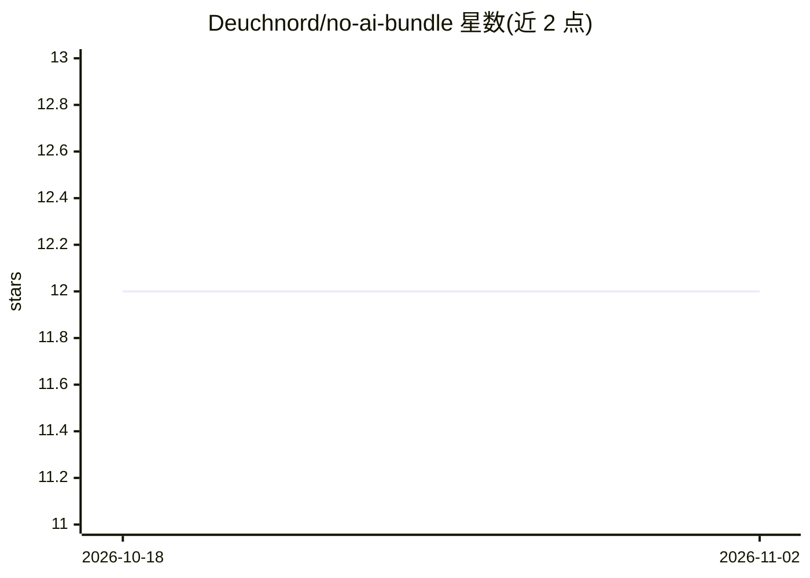

# Deuchnord/no-ai-bundle

⭐ 12 · PHP · EUPL-1.2 · 推送 2026-06-22 · [GitHub](https://github.com/Deuchnord/no-ai-bundle) · [官网](https://packagist.org/packages/deuchnord/no-ai-bundle) · 个人维护

**Symfony 捆绑包：在代码运行前拦截 LLM 爬虫并返回 403**

面向 Symfony 6.4+ / PHP 8.2+ 项目的 Composer 捆绑包，通过检测请求的 User-Agent 识别 LLM 爬虫（如 GPTBot），在应用代码执行前自动返回 403 空白页以节省服务器资源。每次拦截会派发 LlmCrawlerBlockedEvent 事件供监听器处理；当前无配置选项，不支持放行特定爬虫（可通过装饰 LlmDetectionInterface 服务实现）。README 提示 CoPilot 借助 Diffbot 的爬虫被检测为 Diffbot，且阻断可能影响 Amazon 等的推荐功能。

## 筛选速览

| 维度 | 判定 | 备注 |
|---|---|---|
| AI 角色 | `ai-ecosystem` | LLM/agent 周边工具 |
| 许可风险 | `viral` | EUPL-1.2 |
| 部署形态 | `None` |  |
| 模型依赖 | — | README 未给出锁定关系 |
| 硬件要求 | — | 无带数字的原话,不猜 |
| 安装摩擦 | `low` | 无编译、无系统依赖或容器化 |
| 成熟度 | — | 结构信号不足 |

## 能力要点

- User-Agent 检测 LLM 爬虫，在应用代码运行前返回 403
- 每次拦截派发 LlmCrawlerBlockedEvent 事件可监听
- composer require 即装即用，默认配置开箱拦截

## 适用场景

- 阻止 LLM 爬虫抓取我的 Symfony 站点内容
- 减少爬虫带来的服务器资源消耗
- 在拦截事件中记录或自定义处理逻辑

## 场景标签

 · 领域:Web 开发/爬虫防护

## 证据(README 行号)

> L5: A simple Symfony bundle that blocks large language model (LLM) crawlers.
> L6: When an LLM tries to load a page of your website, a `403 Forbidden` will be automatically returned before your code 

## 星数曲线

2026-10-18 12 → 2026-11-02 12（+0）

---
*卡片 v1 · prompt 1.4 · 生成 2026-11-01 · 置信度 high · 依据 README sha `7510820df62b` · [字段定义](../../DATASET.md)*
