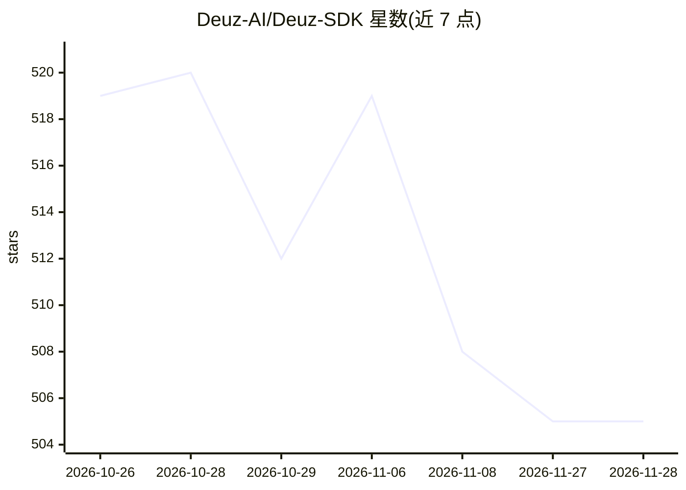

# Deuz-AI/Deuz-SDK

⭐ 505 · TypeScript · MIT · 推送 2026-11-24 · [GitHub](https://github.com/Deuz-AI/Deuz-SDK) · [官网](https://deuz-sdk.tech) · 个人维护

**给开发者的 TypeScript AI SDK：构建带预算与收据的 agent**

TypeScript 库，在自己的进程中调用多提供商模型并运行 agent 与多 agent swarm：统一流式 API、结构化输出与工具调用，附带跨进程共享的持久化 token/USD 预算（估算不通过则发送前拒绝）、工具调用收据与崩溃恢复、HMAC 签名审批、MCP 客户端/服务端、A2A、版本化记忆与上下文编译。发布 core、react、ai-sdk-provider、mcp-ledger、cli 五个包，ESM+CommonJS，core 零运行时依赖，SQLite 存储需 Node.js 22.13+。限制：预算基于估算，近上限调用可能超支。

## 筛选速览

| 维度 | 判定 | 备注 |
|---|---|---|
| AI 角色 | `ai-ecosystem` | LLM/agent 周边工具 |
| 许可风险 | `permissive` | MIT |
| 部署形态 | `self-host` | docker 或自建部署 |
| 模型依赖 | locked-api |  |
| 硬件要求 | — | 无带数字的原话,不猜 |
| 安装摩擦 | `low` | 无编译、无系统依赖或容器化 |
| 成熟度 | — | 结构信号不足 |

## 能力要点

- 一个 API 覆盖多提供商：流式、结构化输出、工具调用、嵌入、realtime 语音与批量请求
- 持久化跨进程预算与工具调用收据，resume 复用已记录结果而非重跑工具
- MCP 客户端/服务端、A2A 互操作与 OpenTelemetry 观测桥
- meter 代理可为 Claude Code/Codex 等编码 agent 套加预算，超限返回 402

## 适用场景

- 构建需要控制花费并留审计收据的生产 agent 应用
- 为 Claude Code/Codex 等编码 agent 设置美元预算代理
- 跨进程编排多 agent swarm 并在崩溃后恢复运行
- 将现有 Vercel AI SDK 应用迁移到 Deuz

## 场景标签

`Agent 框架` `多智能体` `编码 Agent` · 领域:Agent 开发

## 证据(README 行号)

> L5: **One TypeScript SDK. Models, agents, and swarms.**
> L50: - **Models** — one API across providers: streaming, structured output, tool calls, embeddings, realtime voice and b
> L58: - **Interop** — an MCP client and MCP server, and A2A (Agent2Agent) to call other agents and serve your own.

## 星数曲线

2026-10-26 519 → 2026-11-28 505（-14）

---
*卡片 v1 · prompt 1.4 · 生成 2026-11-27 · 置信度 mid · 依据 README sha `410a56d95fcc` · [字段定义](../../DATASET.md)*
