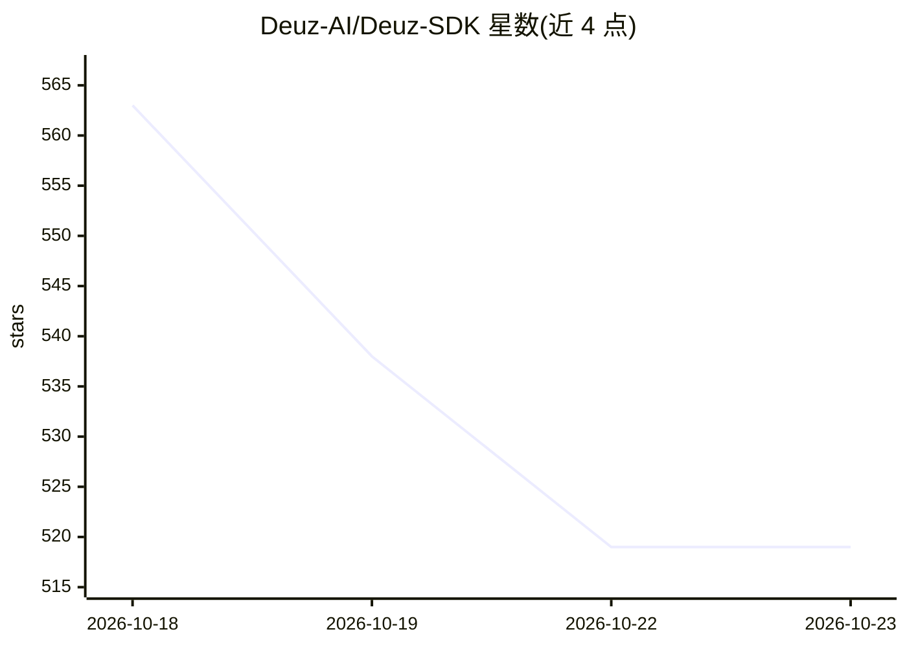

# Deuz-AI/Deuz-SDK

⭐ 519 · TypeScript · MIT · 推送 2026-10-16 · [GitHub](https://github.com/Deuz-AI/Deuz-SDK) · [官网](https://deuz-sdk.tech) · 个人维护

**零依赖 TypeScript AI Agent 框架：模型、Agent 与群体编排**

TypeScript AI SDK 与 agent 框架，核心零运行时依赖，支持 29 个模型供应商。面向构建生产级 agent 与多 agent 群体：提供持久化执行（崩溃后恢复、租约、跨进程取消）、版本化长期记忆与上下文编译器、检索与压缩、MCP 客户端/服务端、A2A 互操作、human-in-the-loop 审批、本地 Docker 代码沙箱（预览）与实时语音。持久化支持 SQLite/Postgres/Redis。要求 Node.js 22+ 或支持 Web APIs 的边缘运行时；2.4 功能默认全部关闭。

## 筛选速览

| 维度 | 判定 | 备注 |
|---|---|---|
| AI 角色 | `ai-ecosystem` | LLM/agent 周边工具 |
| 许可风险 | `permissive` | MIT |
| 部署形态 | `self-host` | docker 或自建部署 |
| 模型依赖 | — | README 未给出锁定关系 |
| 硬件要求 | — | 无带数字的原话,不猜 |
| 安装摩擦 | `low` | 无编译、无系统依赖或容器化 |
| 成熟度 | `idea` | |

## 能力要点

- 核心零必需运行时依赖，集成用可选 peer 依赖
- 持久化执行：崩溃恢复、租约、不重复外部影响的续跑
- 版本化记忆与上下文编译器（token 预算内组装记忆/文档/历史）
- MCP client/server、A2A、审批流与本地 Docker 沙箱（预览）

## 适用场景

- 用 TypeScript 构建跨天运行的持久化生产 agent
- 编排带任务依赖与共享黑板的多 agent 群体
- 为 agent 接入 MCP 工具与 A2A agent 互操作
- 带审批与预算控制的代码执行场景

## 场景标签

`Agent 框架` `多智能体` `Agent 记忆` · 领域:Agent 开发

## 证据(README 行号)

> L3: **One TypeScript SDK. Models, agents, and swarms.**
> L32: - **Models** — multiple providers, streaming, structured output, tool calls, realtime voice, and batch requests.
> L38: - **Interop** — an MCP server, and A2A to call other agents and serve your own.

## 星数曲线

2026-10-18 563 → 2026-10-23 519（-44）

---
*卡片 v1 · prompt 1.4 · 生成 2026-10-21 · 置信度 mid · 依据 README sha `8fac1e87b97c` · [字段定义](../../DATASET.md)*
