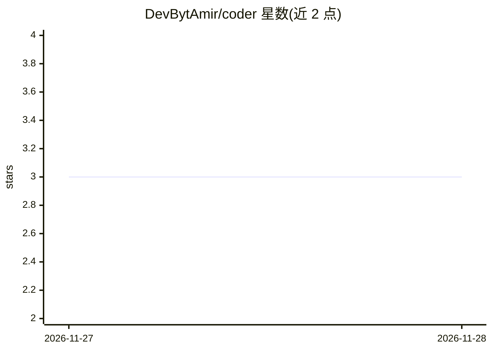

# DevBytAmir/coder

⭐ 3 · Rust · Apache-2.0 · 推送 2026-11-24 · [GitHub](https://github.com/DevBytAmir/coder) · 个人维护

**给 aider/opencode/Claude Code 提供沙箱隔离与 API 密钥保护的启动器**

Rust 编写的 CLI，在 rootless podman 容器内启动 AI 编码 agent（aider、opencode、Claude Code）。核心机制是把持有真实 API 密钥的代理容器与 agent 容器分离：agent 容器运行在无出口的 --internal 网络上，仅凭短时会话令牌访问代理端口，真实密钥与外网出口只存在于代理容器。提供会话令牌签发/撤销、超时控制、沙箱目录守卫、退出码约定，以及供 Claude Code/Codex 安装的 agent 插件（含 PreToolUse 钩子阻止 agent 读取密钥文件）。不缓解 agent 在挂载文件系统内的越权访问，需用户自行控制挂载范围。

## 筛选速览

| 维度 | 判定 | 备注 |
|---|---|---|
| AI 角色 | `ai-ecosystem` | LLM/agent 周边工具 |
| 许可风险 | `permissive` | Apache-2.0 |
| 部署形态 | `None` |  |
| 模型依赖 | local-ok | 支持本地模型 |
| 硬件要求 | — | 无带数字的原话,不猜 |
| 安装摩擦 | `low` | 无编译、无系统依赖或容器化 |
| 成熟度 | — | 结构信号不足 |

## 能力要点

- 密钥与 agent 进程隔离：仅代理容器持有真实 API 密钥与外网出口
- agent 容器运行于无出口的 rootless podman --internal 网络
- 支持脚本/CI/其他 agent 驱动：--yes、--timeout、退出码约定
- 提供 Claude Code/Codex 插件与 PreToolUse 钩子阻止 agent 读取密钥

## 适用场景

- 让自主编码 agent 在隔离沙箱中读写项目代码
- 防止 agent 进程读取并外传真实提供商 API 密钥
- 在 CI 或其他 agent 流程中无人值守地驱动编码工具

## 场景标签

`编码 Agent` · 领域:编码与开发

## 证据(README 行号)

> L8: `coder` is a Rust CLI that launches sandboxed AI coding agents (aider,
> L21: anywhere. `coder` closes that hole by splitting the agent container
> L170: The `coder` plugin teaches a coding agent on the host to delegate tasks

## 星数曲线

2026-11-27 3 → 2026-11-28 3（+0）

---
*卡片 v1 · prompt 1.4 · 生成 2026-11-27 · 置信度 high · 依据 README sha `ca043ec9d7ab` · [字段定义](../../DATASET.md)*
