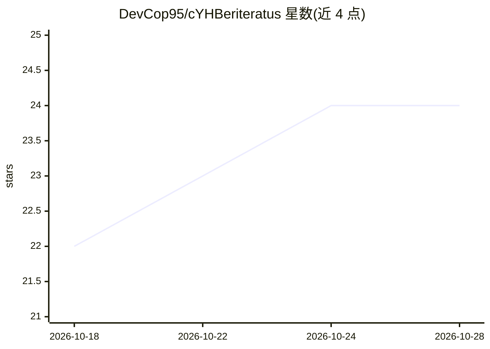

# DevCop95/cYHBeriteratus

⭐ 24 · JavaScript · MIT · 推送 2026-10-08 · [GitHub](https://github.com/DevCop95/cYHBeriteratus) · 个人维护

**面向安全工程师的本地 LLM 网页客户端，接 Ollama 用 abliterated 模型**

基于 Node.js 的 ChatGPT 风格本地 Web 界面，以 Ollama 为后端运行 abliterated（去审查）模型，提供流式对话、推理过程展示、会话持久化（内存存储、24h TTL）与 Agent 工具调用：文件读写、PowerShell 命令、网页抓取/搜索，以及单目标安全侦察工具（DNS 解析、端口扫描、HTTP 头审计、TLS 证书检查、哈希计算）。零 npm 依赖，使用原生 Node 模块；含 SSRF 阻断、目录沙箱、速率限制等安全机制。Agent 模式需支持 tool calling 的模型。

## 筛选速览

| 维度 | 判定 | 备注 |
|---|---|---|
| AI 角色 | `ai-ecosystem` | LLM/agent 周边工具 |
| 许可风险 | `permissive` | MIT |
| 部署形态 | `desktop` | 安装包/桌面程序 |
| 模型依赖 | local-ok | 支持本地模型 |
| 硬件要求 | — | 无带数字的原话,不猜 |
| 安装摩擦 | `low` | 无编译、无系统依赖或容器化 |
| 成熟度 | — | 结构信号不足 |

## 能力要点

- 以 Ollama 为后端的零依赖 Node.js 本地聊天界面，支持 abliterated 模型
- Agent 工具调用：文件/命令/web 工具 + 单目标安全侦察（DNS/端口/HTTP 头/TLS/哈希）
- 74 个内置测试（node:test），含 SSRF 与路径沙箱防护测试
- 脚本 detect-abliterated.py 列出已安装的 abliterated 模型

## 适用场景

- 本地无过滤地与 LLM 讨论漏洞分析与脚本编写
- 在授权红队场景下让模型执行单目标侦察工具
- 以本地方式运行 Qwen3 等 abliterated 模型并查看推理过程

## 场景标签

`聊天机器人` `AI 助手` `网络安全` · 领域:对话与助手

## 证据(README 行号)

> L10: A local, ChatGPT-style web interface wired to `Ollama` that supports **Autonomous Agents (Tool Calling)**, **ablite
> L25: - **Agent Engine (Tools):** The model can run real actions on your machine when agent mode is enabled:
> L30: - **Security recon tools (authorized red-team use):** single-target reconnaissance and analysis helpers:

## 星数曲线

2026-10-18 22 → 2026-10-28 24（+2）

---
*卡片 v1 · prompt 1.4 · 生成 2026-10-27 · 置信度 mid · 依据 README sha `db8c19b8aaab` · [字段定义](../../DATASET.md)*
