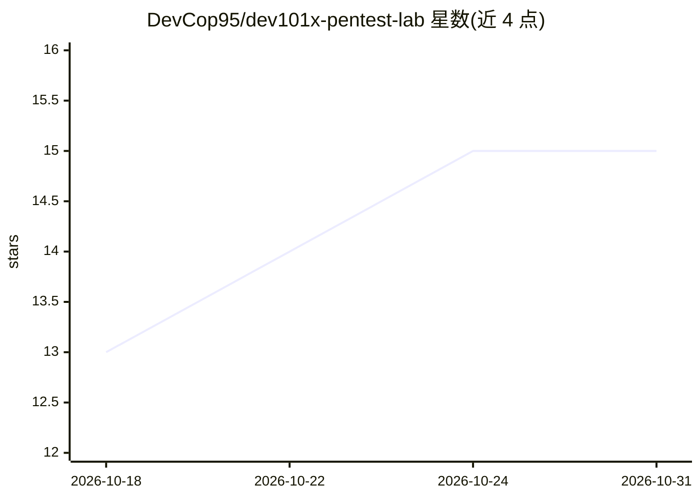

# DevCop95/dev101x-pentest-lab

⭐ 15 · Python · 推送 2026-09-16 · [GitHub](https://github.com/DevCop95/dev101x-pentest-lab) · 个人维护

**自包含 Docker 渗透测试练习靶场：Web 入口到提权全程**

单机运行的 Docker 渗透练习环境，模拟 Pro Lab 结构（Web 突破→内网横向→提权→root），无需 VPN 或外部账号。攻击路径包含布尔盲注、hashcat 离线破解、路径穿越、命令注入、网络 pivoting 与 SUID PATH 劫持提权共 8 步。每次部署由 gen_flags.sh 生成随机 flag，Web 端实时验证，3/3 完成后可生成 PDF 完成证书。提供面向学生的密封分发打包脚本（只含镜像与 compose 文件）。

## 筛选速览

| 维度 | 判定 | 备注 |
|---|---|---|
| AI 角色 | `ai-knowledge` | 知识聚合/清单类 |
| 许可风险 | `none` | — |
| 部署形态 | `self-host` | docker 或自建部署 |
| 模型依赖 | — | README 未给出锁定关系 |
| 硬件要求 | — | 无带数字的原话,不猜 |
| 安装摩擦 | `low` | 无编译、无系统依赖或容器化 |
| 成熟度 | — | 结构信号不足 |

## 能力要点

- 8 步攻击路径：盲注/破解/穿越/注入/横向/提权
- 每次部署生成随机 flag，实时在线验证
- 3/3 完成后生成带验证 ID 的 PDF 证书
- pack_student.sh 密封学生分发包（不含源码与答案）

## 适用场景

- 在本地练习 Web 突破到提权的完整渗透链路
- 培训班为每个学员分发生成独立 flag 的实例
- 验证渗透技能并获取完成证书

## 场景标签

`网络安全` · 领域:学习与行业

## 证据(README 行号)

> L5: Self-contained Docker Pro Lab (medium): web foothold → pivot → root.
> L9: Self-contained Docker lab modeled after a Pro Lab structure (web foothold → pivoting → privesc → root).

## 星数曲线

2026-10-18 13 → 2026-10-31 15（+2）

---
*卡片 v1 · prompt 1.4 · 生成 2026-10-31 · 置信度 low · 依据 README sha `dca66d14dca6` · [字段定义](../../DATASET.md)*
