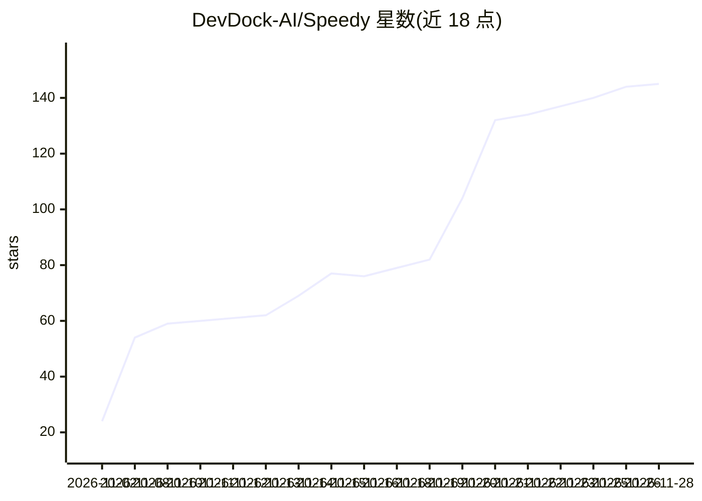

# DevDock-AI/Speedy

⭐ 145 · C++ · NOASSERTION · 推送 2026-11-24 · [GitHub](https://github.com/DevDock-AI/Speedy) · 个人维护

**在消费级 RTX 显卡上本地运行大 MoE 模型的推理服务器**

Strata 的一个测量与调优分支：在消费级 NVIDIA RTX 20-50 显卡上运行 Qwen3.8-Flash-Next（125B MoE）、DeepSeek V4.1-Flash 等开放权重模型，通过 OpenAI 与 Anthropic 兼容 API 对外提供服务，面向编码 Agent 场景内置循环打断、工具调用修复、思考预算与答案保留等服务器端机制。默认上下文 229K，可配置到 1M；README 提供 Windows 脚本安装与 Linux 源码编译路径，并附 Terminal-Bench 子集、速度与召回基准。

## 筛选速览

| 维度 | 判定 | 备注 |
|---|---|---|
| AI 角色 | `ai-ecosystem` | LLM/agent 周边工具 |
| 许可风险 | `none` | NOASSERTION |
| 部署形态 | `None` |  |
| 模型依赖 | — | README 未给出锁定关系 |
| 硬件要求 | — | 无带数字的原话,不猜 |
| 安装摩擦 | `high` | 编译与系统依赖俱全 |
| 成熟度 | — | 结构信号不足 |

## 能力要点

- 通过 OpenAI/Anthropic 兼容 API 服务本地模型，OpenCode、Claude Code、Codex CLI 等客户端可直连
- 服务器端循环打断与工具调用修复，面向编码 Agent
- 单/双 RTX 3080 的逐档速度基准与 1M 上下文召回检查
- 支持 Qwen3.8-Flash-Next 4-bit 文件，229K 上下文可增长至 1M

## 适用场景

- 在自己 RTX 显卡上本地运行大参数 MoE 模型给编码 Agent 用
- 给 OpenCode/Claude Code 等客户端替换 base URL 使用本地模型
- 长上下文会话（数十万 token）下的编码与调试任务

## 场景标签

`推理引擎` · 领域:训练与推理

## 证据(README 行号)

> L14: Speedy runs large open-weight models on consumer NVIDIA cards and serves them over the OpenAI and Anthropic APIs.
> L61: **Then point your client at it.** The server speaks the OpenAI and Anthropic APIs, so OpenCode, Claude Code, Codex 

## 星数曲线

2026-11-02 24 → 2026-11-28 145（+121）

---
*卡片 v1 · prompt 1.4 · 生成 2026-11-27 · 置信度 high · 依据 README sha `f21cf026802d` · [字段定义](../../DATASET.md)*
