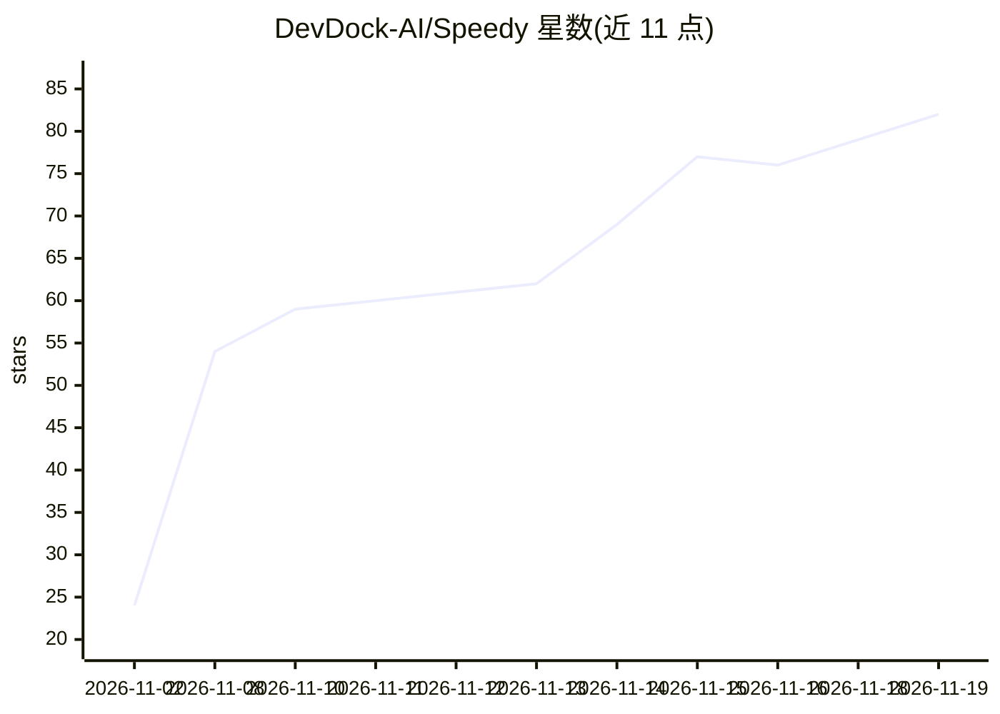

# DevDock-AI/Speedy

⭐ 82 · C++ · NOASSERTION · 推送 2026-11-18 · [GitHub](https://github.com/DevDock-AI/Speedy) · 组织维护

**在消费级 RTX 3080 上运行 125B MoE 模型长上下文推理的引擎（Strata 分支）**

Strata 的测量与调优分支：在单张或双张 RTX 3080 10 GB 上运行 Qwen3.8-Flash-Next（125B MoE），提供 229K 原生上下文与 1M token 档位。每个引擎改动均经同窗口 A/B 与质量门（token 级比对、编码任务、长上下文针召回）。README 给出多张卡的 prefill/decode 基准数据，提供 Linux 源码构建与 Windows 一键安装两种途径，量化预设按 GPU 型号组织于 configs/cards/。许可为个人与非商业用途，仅针对特定模型调优，其他 GPU 未测量。

## 筛选速览

| 维度 | 判定 | 备注 |
|---|---|---|
| AI 角色 | `ai-ecosystem` | LLM/agent 周边工具 |
| 许可风险 | `none` | NOASSERTION |
| 部署形态 | `desktop` | 安装包/桌面程序 |
| 模型依赖 | — | README 未给出锁定关系 |
| 硬件要求 | — | 无带数字的原话,不猜 |
| 安装摩擦 | `high` | 编译与系统依赖俱全 |
| 成熟度 | — | 结构信号不足 |

## 能力要点

- Qwen3.8-Flash-Next 125B MoE 在 1-2 张 RTX 3080 10 GB 上运行，最高 1M token 上下文
- 每个改动经同窗口 A/B 与质量门验证，基准数据附测量方法与噪声范围
- 按 GPU 型号组织的量化预设（Q2_0 到 UD-Q4_K_XL）可复现文档数据
- 支持双卡 layer split、MTP 推测解码与 llama-swap 多量化共享端口

## 适用场景

- 在消费级显卡上本地运行 125B MoE 模型处理超长上下文任务
- 长会话编码场景中维持百万级 token 的上下文与召回
- 按文档基准数据选择适合自己显存与速度需求的量化方案

## 场景标签

`推理引擎` · 领域:训练与推理

## 证据(README 行号)

> L1: Speedy LLM inference
> L5: Speedy runs **Qwen3.8-Flash-Next** (125B MoE) with a **229K-token native context** and a **1M-token tier** on one or
> L6: **RTX 3080 10 GB** cards. It is a measured, tuned fork of Strata. Every change in

## 星数曲线

2026-11-02 24 → 2026-11-19 82（+58）

---
*卡片 v1 · prompt 1.4 · 生成 2026-11-18 · 置信度 high · 依据 README sha `02cf3b396a48` · [字段定义](../../DATASET.md)*
