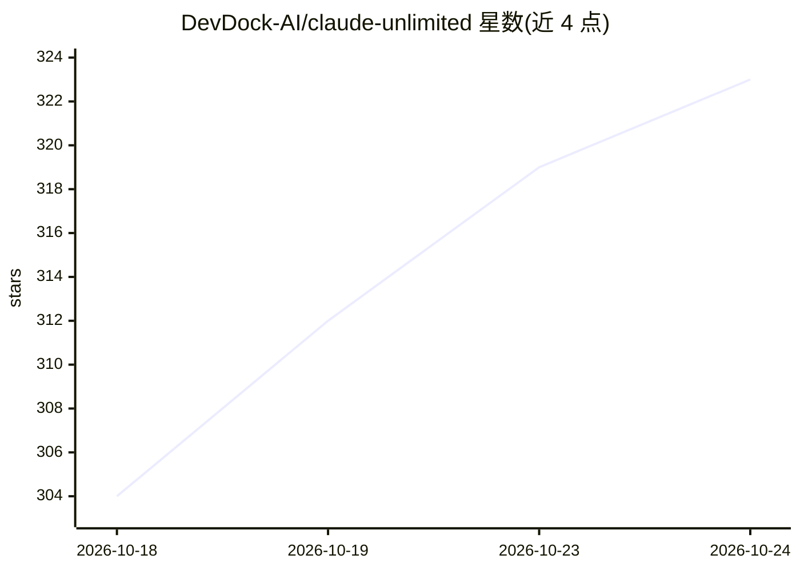

# DevDock-AI/claude-unlimited

⭐ 323 · Python · MIT · 推送 2026-09-23 · [GitHub](https://github.com/DevDock-AI/claude-unlimited) · [官网](https://github.com/DevDock-AI/claude-unlimited#readme) · 组织维护

**在 Claude Code 内轮换 Claude/ChatGPT 订阅与 API key 的本地代理**

面向 Claude Code 用户的本地代理/守护进程：把多个 Claude Pro/Max 订阅、ChatGPT/Codex 订阅和 Anthropic API key 汇入一个池，账户额度用尽时在请求间自动切换，会话与上下文不中断；Codex 请求被翻译为 Anthropic API 形态（含流式），并可编辑 Claude→GPT 模型映射。自带 127.0.0.1 仪表盘展示用量/成本/活动日志，凭据存于系统钥匙串，无遥测、无云端组件。macOS 为主要测试平台，Windows/Linux 为尽力支持；需 Python 3.10+ 与 claude CLI。

## 筛选速览

| 维度 | 判定 | 备注 |
|---|---|---|
| AI 角色 | `ai-ecosystem` | LLM/agent 周边工具 |
| 许可风险 | `permissive` | MIT |
| 部署形态 | `library` | 以包/库形式分发 |
| 模型依赖 | locked-api |  |
| 硬件要求 | — | 无带数字的原话,不猜 |
| 安装摩擦 | `low` | 无编译、无系统依赖或容器化 |
| 成熟度 | `idea` | |

## 能力要点

- 多账户混合池，请求间自动轮换，会话不重启
- Codex 账户翻译为 Anthropic API 形态，含流式与模型映射表
- 本地仪表盘：用量、成本、项目归因、活动日志、HUD
- 凭据存 OS 钥匙串（Keychain/Secret Service/DPAPI），无遥测

## 适用场景

- 单账户额度用尽时不中断 Claude Code 会话
- 把 Claude 订阅、ChatGPT 订阅和 API key 混用一个池
- 在仪表盘里查看各账户用量与花费统计

## 场景标签

`模型网关` · 领域:Agent 开发

## 证据(README 行号)

> L82:       │   ANTHROPIC_BASE_URL=http://127.0.0.1:4317
> L86: **The rotation is invisible to Claude Code.** It sends one request, gets one answer. It is

## 星数曲线

2026-10-18 304 → 2026-10-24 323（+19）

---
*卡片 v1 · prompt 1.4 · 生成 2026-10-22 · 置信度 mid · 依据 README sha `6eb6cb76ac57` · [字段定义](../../DATASET.md)*
