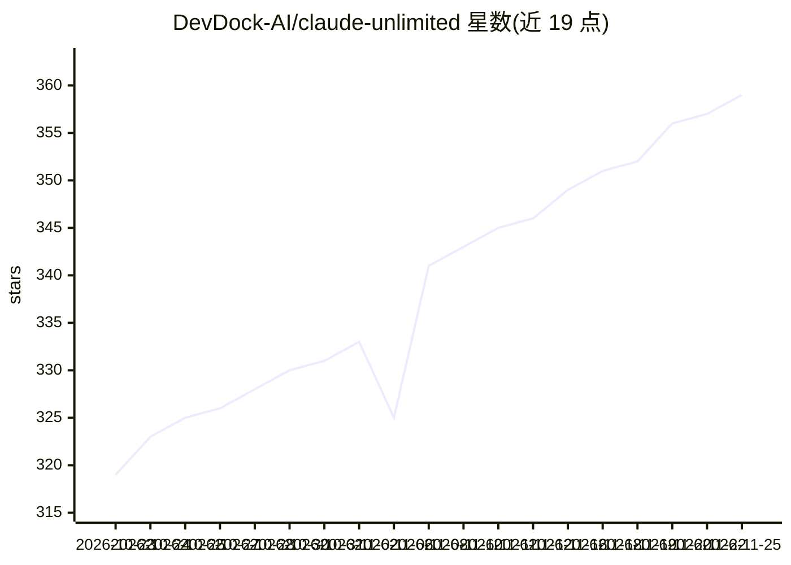

# DevDock-AI/claude-unlimited

⭐ 359 · Python · MIT · 推送 2026-11-19 · [GitHub](https://github.com/DevDock-AI/claude-unlimited) · [官网](https://github.com/DevDock-AI/claude-unlimited#readme) · 组织维护

**给 Claude Code 用户做多账号额度轮换的本地代理与面板**

本地运行的代理与仪表盘：将 Claude（Pro/Max/Ultra）订阅、ChatGPT/Codex 订阅与 Anthropic API key 汇成一个池，供 Claude Code CLI 使用；某账号触达用量上限时在请求间自动切换到下一账号，会话与上下文不中断。Codex 账号经 API 形状转换后可服务 Claude Code，模型映射与计费配额由用户配置。提供用量条、成本统计、活动日志等面板，凭据存于 OS 密钥库。macOS 为主测平台，Windows/Linux 为 best-effort；需 Python 3.10+、git 与 claude CLI。

## 筛选速览

| 维度 | 判定 | 备注 |
|---|---|---|
| AI 角色 | `ai-ecosystem` | LLM/agent 周边工具 |
| 许可风险 | `permissive` | MIT |
| 部署形态 | `library` | 以包/库形式分发 |
| 模型依赖 | locked-api |  |
| 硬件要求 | — | 无带数字的原话,不猜 |
| 安装摩擦 | `low` | 无编译、无系统依赖或容器化 |
| 成熟度 | — | 结构信号不足 |

## 能力要点

- 账号触顶时在请求间无缝轮换，会话不中断
- Codex/ChatGPT 账号与 Anthropic API 形状双向转换，支持 token 级流式
- 本地仪表盘：用量、成本、按项目归因与活动日志
- 100% 本地：无遥测，凭据存于 Keychain/Secret Service/DPAPI

## 适用场景

- 多个 Claude/ChatGPT 订阅轮着用，避免用量中断编码会话
- 在 Claude Code 中通过 Codex 账号运行 GPT 模型
- 本地查看各账号用量与成本统计

## 场景标签

`模型网关` · 领域:Agent 开发

## 证据(README 行号)

> L5: Claude Unlimited pools your Claude (Pro · Max · Ultra), ChatGPT/Codex, and Anthropic API accounts
> L64: ||**The codex CLI too** — `cu codex` runs OpenAI's own CLI on the pool's ChatGPT accounts, moving to the next one w
> L97: - **No account. No sign-up. No cloud component.** There is no Claude Unlimited server. It

## 星数曲线

2026-10-23 319 → 2026-11-25 359（+40）

---
*卡片 v1 · prompt 1.4 · 生成 2026-11-25 · 置信度 mid · 依据 README sha `addf2af9c197` · [字段定义](../../DATASET.md)*
