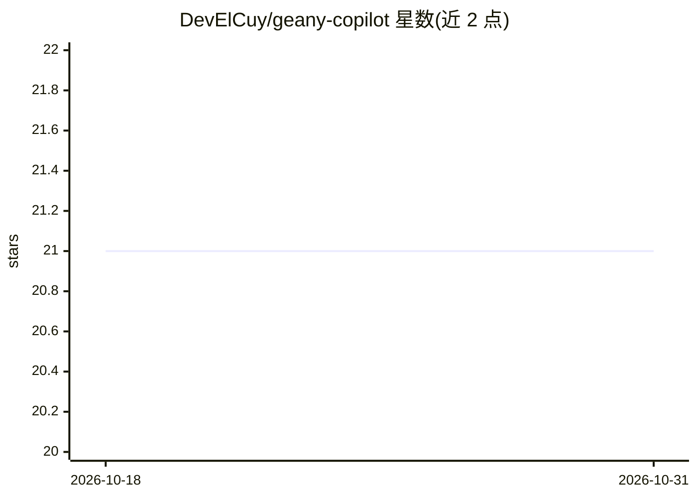

# DevElCuy/geany-copilot

⭐ 21 · Rust · MIT · 推送 2026-09-13 · [GitHub](https://github.com/DevElCuy/geany-copilot) · 个人维护

**Geany IDE 的 AI 补全/改写插件，接 Ollama 与 OpenAI 兼容后端**

用 Rust 编写并手写 FFI 绑定的 Geany 原生插件（v0.2，重写自早期 Lua 脚本版）。触发后取光标前后约 100 字符或当前选区作为上下文，连同可选语言提示与系统提示经 curl 以 SSE 流式发送至后端，完成后按插入模式（光标处/替换选区/追加）写回文档。后端支持 Ollama 与 OpenAI 兼容 API（含 DeepSeek 及流式 reasoning_content 的推理模型），支持多预设管理、实时 token 统计与 thinking 日志。构建需 Geany 2.0 开发头文件与 libcurl，绑定特定插件 ABI/API 版本，不保证在其他 Geany 版本加载。

## 筛选速览

| 维度 | 判定 | 备注 |
|---|---|---|
| AI 角色 | `ai-enhanced` | 去掉 AI 部分产品仍成立 |
| 许可风险 | `permissive` | MIT |
| 部署形态 | `library` | 以包/库形式分发 |
| 模型依赖 | local-ok | 支持本地模型 |
| 硬件要求 | — | 无带数字的原话,不猜 |
| 安装摩擦 | `medium` | 含编译或系统依赖之一 |
| 成熟度 | — | 结构信号不足 |

## 能力要点

- Ollama 与 OpenAI 兼容 API 双后端，支持推理模型的 reasoning_content 流式日志
- 多命名预设管理（后端/URL/模型/API key/系统提示/温度/插入模式），可拉取后端实时模型列表
- 三种插入模式与基于文件扩展名的语言提示
- 65 个单元测试覆盖后端逻辑、配置持久化与流式状态机

## 适用场景

- 在 Geany 中对选中代码调用 LLM 生成或改写
- 接入本地 Ollama 模型在编辑器内获得 AI 辅助
- 通过快捷键快速切换不同模型/后端预设

## 场景标签

`代码生成` · 领域:编码与开发

## 证据(README 行号)

> L3: A native Geany plugin that sends the text around
> L4: your cursor (or your current selection) to an LLM backend and inserts the
> L5: response back into the document — a lightweight, editor-native AI assistant.

## 星数曲线

2026-10-18 21 → 2026-10-31 21（+0）

---
*卡片 v1 · prompt 1.4 · 生成 2026-10-28 · 置信度 high · 依据 README sha `8e698cb21b98` · [字段定义](../../DATASET.md)*
