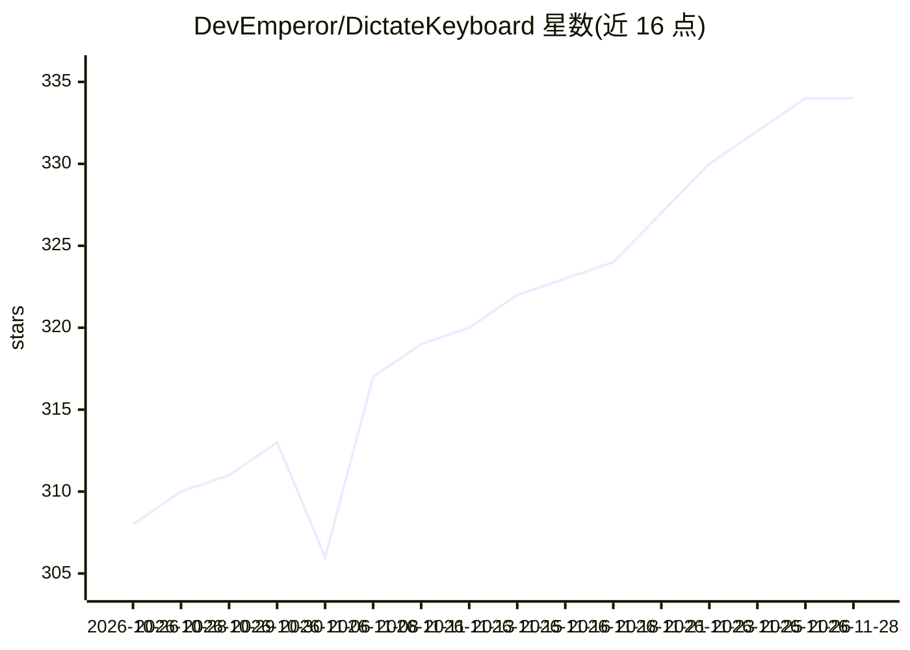

# DevEmperor/DictateKeyboard

⭐ 334 · Kotlin · Apache-2.0 · 推送 2026-11-26 · [GitHub](https://github.com/DevEmperor/DictateKeyboard) · [官网](https://dictatekeyboard.com) · 个人维护

**Android AI 键盘：任意应用内语音听写与实时转写**

面向 Android 用户的听写键盘应用：按住麦克风说话即可在任意应用中实时生成带标点的文本，同时具备完整的打字键盘功能（滑行输入、联想词、自动纠错）。语音引擎可自选：OpenAI Whisper、Gemini、Deepgram、Soniox、ElevenLabs 等云端服务，或下载到手机本地的离线模型。支持自定义 AI 改写提示（正式化、翻译、摘要）、语音消息转写、转写历史、Wear OS 手表端，以及四种供电方式（自有 API key、自建服务器、本地模型、预付额度）并可配置回退。通过 Google Play 付费分发。

## 筛选速览

| 维度 | 判定 | 备注 |
|---|---|---|
| AI 角色 | `ai-native` | 本体是模型或模型工具 |
| 许可风险 | `permissive` | Apache-2.0 |
| 部署形态 | `None` |  |
| 模型依赖 | — | README 未给出锁定关系 |
| 硬件要求 | — | 无带数字的原话,不猜 |
| 安装摩擦 | `low` | 无编译、无系统依赖或容器化 |
| 成熟度 | — | 结构信号不足 |

## 能力要点

- 多引擎可选的语音听写，支持百余种语言与自动标点
- 可下载本地模型完全离线转写（含 Whisper、Parakeet、Canary、Dolphin）
- 自定义 AI 改写提示与社区提示库，支持语音命令式改写
- 注册为系统级语音输入，其他键盘的麦克风键可经 Dictate 转写

## 适用场景

- 在任意应用里用语音替代打字输入文字
- 无网络环境下用本地模型听写
- 把聊天里的语音消息转成可搜索的文本
- 对选中文本用 AI 提示做翻译、摘要或改写

## 场景标签

`语音识别` `AI 写作` · 领域:内容生成

## 证据(README 行号)

> L7: A powerful AI keyboard for dictation, real-time transcription and typing — with Whisper and many
> L53: **Dictate** is an easy-to-use keyboard for transcribing and dictating. The speech engine is
> L68: There are four ways to power it, and you pick one during setup: **your own API key** with the

## 星数曲线

2026-10-26 308 → 2026-11-28 334（+26）

---
*卡片 v1 · prompt 1.4 · 生成 2026-11-25 · 置信度 high · 依据 README sha `11ad710898c6` · [字段定义](../../DATASET.md)*
