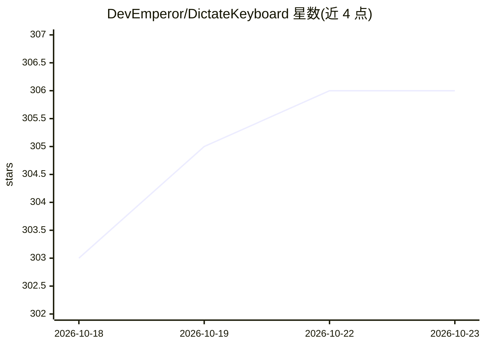

# DevEmperor/DictateKeyboard

⭐ 306 · Kotlin · Apache-2.0 · 推送 2026-10-22 · [GitHub](https://github.com/DevEmperor/DictateKeyboard) · [官网](https://dictatekeyboard.com) · 个人维护

**Android AI 语音听写键盘：多引擎实时转文字**

基于 Kotlin/Jetpack Compose、构建于 FlorisBoard 之上的 Android 键盘应用，核心功能为语音听写与实时转录：支持 OpenAI Whisper、Gemini、Deepgram、Soniox、EleLabs 等云端引擎，也可下载模型在设备上离线转录；并提供 AI 改写（翻译/摘要/改语气，OpenAI、Anthropic、Gemini 等模型，可用自有 API key、自建服务器、端侧模型或预付额度）。同时是完整键盘：滑行输入、40+ 语言词典、自动纠错，另含 Wear OS、悬浮听写按钮、离线翻译、文字扫描等功能。通过 Google Play 收费分发。

## 筛选速览

| 维度 | 判定 | 备注 |
|---|---|---|
| AI 角色 | `ai-native` | 本体是模型或模型工具 |
| 许可风险 | `permissive` | Apache-2.0 |
| 部署形态 | `None` |  |
| 模型依赖 | — | README 未给出锁定关系 |
| 硬件要求 | — | 无带数字的原话,不猜 |
| 安装摩擦 | `low` | 无编译、无系统依赖或容器化 |
| 成熟度 | — | 结构信号不足 |

## 能力要点

- 多云端引擎（Whisper/Gemini/Deepgram/Soniox/ElevenLabs 等）+ 端侧离线模型实时转录
- AI 改写与自定义提示词，支持 OpenAI/Anthropic/Gemini 等提供商及自有 API key
- 完整键盘功能：滑行输入、下一词预测、40+ 语言词典与自动纠错
- Wear OS 手表听写、悬浮按钮、离线翻译（Firefox Translations 49 语言）

## 适用场景

- 在任意应用中用语音代替打字输入文字
- 离线场景下用端侧模型做隐私保护的听写
- 把口述内容直接翻译、摘要或改写为正式文体

## 场景标签

`语音识别` `AI 写作` · 领域:内容生成

## 证据(README 行号)

> L63: **Dictate** is an easy-to-use keyboard for transcribing and dictating. The speech engine is
> L78: There are four ways to power it, and you pick one during setup: **your own API key** with the

## 星数曲线

2026-10-18 303 → 2026-10-23 306（+3）

---
*卡片 v1 · prompt 1.4 · 生成 2026-10-21 · 置信度 high · 依据 README sha `b52db39bf215` · [字段定义](../../DATASET.md)*
