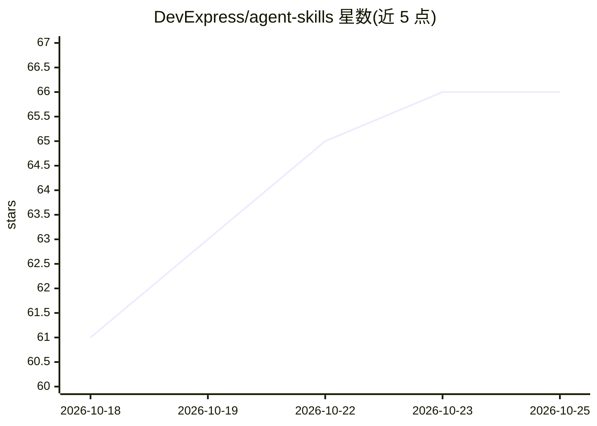

# DevExpress/agent-skills

⭐ 66 · C# · MIT · 推送 2026-10-19 · [GitHub](https://github.com/DevExpress/agent-skills) · [官网](https://www.devexpress.com) · 组织维护

**DevExpress 产品知识的 AI 编码助手技能包，助其生成准确的 DevExpress 代码**

DevExpress 官方维护的 AI agent 技能仓库，面向 GitHub Copilot、Claude Code、Cursor、JetBrains AI Assistant、Codex CLI 等 AI 编码助手。每个技能内含 DevExpress 产品知识：正确的 API、导入路径与可运行代码示例，用于提升 AI 生成 DevExpress 代码的准确性并减少对第三方库的误依赖。覆盖 DevExtreme、Blazor、WPF、WinForms、Reports、XAF 等 10 条产品线。安装途径包括插件市场命令与手动复制技能文件夹到各 agent 的约定目录。配套的 DevExpress 文档 MCP Server 可单独部署。MIT 许可。

## 筛选速览

| 维度 | 判定 | 备注 |
|---|---|---|
| AI 角色 | `ai-ecosystem` | LLM/agent 周边工具 |
| 许可风险 | `permissive` | MIT |
| 部署形态 | `None` |  |
| 模型依赖 | — | README 未给出锁定关系 |
| 硬件要求 | — | 无带数字的原话,不猜 |
| 安装摩擦 | `low` | 无编译、无系统依赖或容器化 |
| 成熟度 | — | 结构信号不足 |

## 能力要点

- 覆盖 10 条 DevExpress 产品线（DevExtreme/Blazor/WPF/WinForms/Reports/XAF 等）的技能包
- 支持 GitHub Copilot、Claude Code、Cursor、JetBrains AI Assistant/Junie、Codex CLI 等多种 agent
- 提供插件市场一键安装与手动复制技能文件夹两种安装方式
- 与 DevExpress Documentation MCP Server（30 万+ 帮助主题）互补使用

## 适用场景

- 在 IDE 或 CLI 的 AI 编码助手中生成 DevExpress 控件代码
- 团队统一为编码 agent 配置 DevExpress API 使用规范
- 减少 AI 生成 DevExpress 代码时的幻觉与第三方库误用

## 场景标签

`提示工程` · 领域:Agent 开发

## 证据(README 行号)

> L5: This repository stores DevExpress AI agent skills for GitHub Copilot, Claude Code, Cursor, JetBrains AI Assistant, a
> L29: The fastest way to obtain DevExpress skills is via plugins. Plugin installation is available in **GitHub Copilot CL

## 星数曲线

2026-10-18 61 → 2026-10-25 66（+5）

---
*卡片 v1 · prompt 1.4 · 生成 2026-10-24 · 置信度 high · 依据 README sha `77fbc0f47f80` · [字段定义](../../DATASET.md)*
