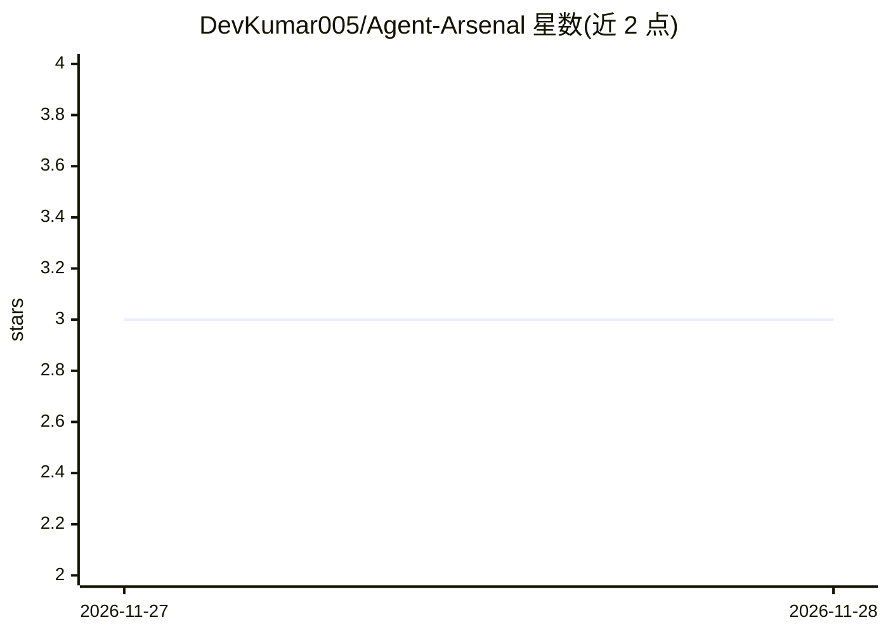

# DevKumar005/Agent-Arsenal

⭐ 3 · NOASSERTION · 推送 2026-11-26 · [GitHub](https://github.com/DevKumar005/Agent-Arsenal) · 个人维护

**AI 编程 agent 技能目录：按需发现、安装与管理技能**

以目录/指南形式组织的 AI agent 技能聚合仓库：收录 Vercel、Anthropic、Google、Red Hat、Trail of Bits 等来源的技能集合，按前端、安全、测试等类别整理。提供 skill-matcher.md 引导匹配 1–3 个合适技能、quick-install.md 按平台的复制粘贴安装命令、sources.txt 维护新增来源，并给出技能数量上限等上下文管理最佳实践。覆盖 Antigravity、Claude Code、Codex CLI、Cursor、Copilot 与本地 LLM，安装依赖 npx skills CLI。PR 目前关闭，仅通过 issue 提交新增请求。

## 筛选速览

| 维度 | 判定 | 备注 |
|---|---|---|
| AI 角色 | `ai-knowledge` | 知识聚合/清单类 |
| 许可风险 | `none` | NOASSERTION |
| 部署形态 | `library` | 以包/库形式分发 |
| 模型依赖 | — | README 未给出锁定关系 |
| 硬件要求 | — | 无带数字的原话,不猜 |
| 安装摩擦 | `low` | 无编译、无系统依赖或容器化 |
| 成熟度 | — | 结构信号不足 |

## 能力要点

- skill-matcher.md 以 5 个问题匹配 1–3 个适配技能并生成 project-brief.md
- 按平台给出技能调用方式（/skill-name、$skill-name、@skill-name）
- sources.txt 的 [TO BE ADDED]/[ADDED] 流程维护来源更新
- 给出技能数量上限等上下文减负规则（云模型 8–12 个，本地 3–5 个）

## 适用场景

- 为不同项目按需挑选并安装对应技能，避免全局装满
- 让 AI agent 读取本仓库自行完成技能安装
- 按角色配置不同技能组合（前端/安全/测试等）

## 场景标签

`精选清单` · 领域:学习与行业

## 证据(README 行号)

> L4: > A curated, bloat-free reference for selecting, installing, and using AI agent skills across **Antigravity**, **Cla
> L51: ├── skills.md               ← Complete catalog of all skills with details
> L77: |Collection|Author|Category|Skills|

## 星数曲线

2026-11-27 3 → 2026-11-28 3（+0）

---
*卡片 v1 · prompt 1.4 · 生成 2026-11-27 · 置信度 high · 依据 README sha `1d1ace64a0f4` · [字段定义](../../DATASET.md)*
