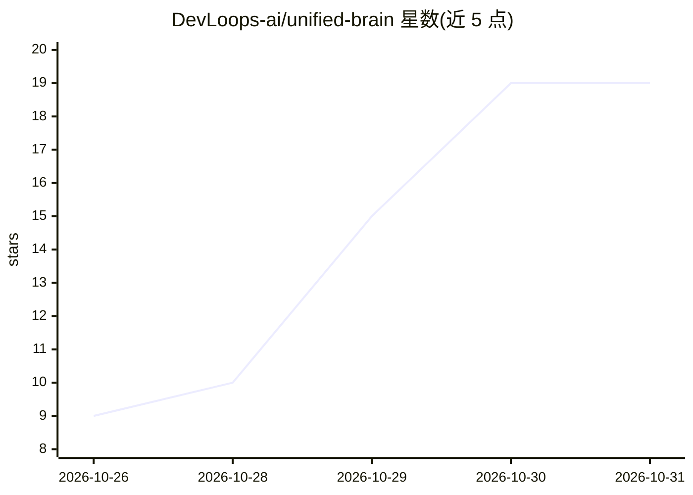

# DevLoops-ai/unified-brain

⭐ 19 · Python · AGPL-3.0 · 推送 2026-10-29 · [GitHub](https://github.com/DevLoops-ai/unified-brain) · [官网](https://www.devloops.ai) · 组织维护

**面向编码 agent 的仓库持久记忆与证据检索层（SQLite+MCP）**

unified-brain 是一个接入各类编码 agent（Cursor、Claude Code、OpenCode 等，经 MCP）的感知/记忆层：用 tree-sitter 读取仓库全部 git 历史，把每个符号的每个版本连同引入 commit 存入仓库内单个 SQLite 库，摄取阶段不调用 LLM，末尾做一次嵌入。回答时经嵌入检索→小型判定模型 Jev 评分跟踪→由任选 LLM 完成一次写作输出；另提供 commit 时间线审查报告。运行需 Python 3.11+，并需 OpenRouter（Jev）、嵌入提供商（Voyage/DeepInfra）与写作提供商（Fireworks/Anthropic）的 API key。作者在 README 中给出 xz 与 open62541 两个基准的 token/成本/耗时数据，并注明跨次可复现性与能耗节省尚未测量。

## 筛选速览

| 维度 | 判定 | 备注 |
|---|---|---|
| AI 角色 | `ai-ecosystem` | LLM/agent 周边工具 |
| 许可风险 | `dual` | AGPL-3.0 |
| 部署形态 | `library` | 以包/库形式分发 |
| 模型依赖 | locked-api |  |
| 硬件要求 | — | 无带数字的原话,不猜 |
| 安装摩擦 | `low` | 无编译、无系统依赖或容器化 |
| 成熟度 | — | 结构信号不足 |

## 能力要点

- 读取全量 git 历史，将每个符号的每个版本存入单个 SQLite 库（摄取阶段无 LLM）
- 检索流程：嵌入 → 小型判定模型 Jev → 一次 LLM 写作
- MCP 服务器（retrieve 工具）接入 Cursor / Claude Code / 任意 MCP 客户端
- commit 时间线报告：判定变更是否符合 commit 信息或存在缺陷/恶意意图

## 适用场景

- 在大型仓库上回答『某符号为何如此实现』这类代码级问题
- 为我的编码 agent 提供跨长会话的持久仓库记忆与证据检索
- 审查一段 commit 区间内每个符号变更的意图与缺陷

## 场景标签

`Agent 记忆` `代码审查` · 领域:Agent 开发

## 证据(README 行号)

> L9: The agent spawned from unified-brain runs through MCP on Cursor, OpenCode or Claude Code etc. allowing you to use it
> L208: `unified_brain_mcp.py` is an MCP server with one tool, `retrieve`: the agent

## 星数曲线

2026-10-26 9 → 2026-10-31 19（+10）

---
*卡片 v1 · prompt 1.4 · 生成 2026-10-30 · 置信度 mid · 依据 README sha `a2c96483e83f` · [字段定义](../../DATASET.md)*
