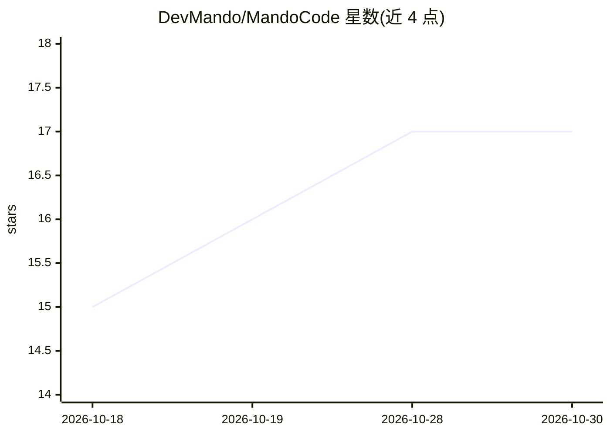

# DevMando/MandoCode

⭐ 17 · C# · MIT · 推送 2026-10-23 · [GitHub](https://github.com/DevMando/MandoCode) · 个人维护

**基于 Ollama 的 .NET 终端 AI 编码助手，多 agent 协作**

以 .NET C# 编写的 CLI/TUI 编码代理，基于 RazorConsole 渲染终端界面、Microsoft Agent Framework 与 Ollama 驱动，可本地运行或连接 Ollama 云端，无需 API key。功能覆盖读写搜索整个代码库、提出 diff 并审批、命名工作区内最多四个独立 agent 通过 @ 协作、上下文快照导入导出、agent 历史恢复、MCP 服务器与 Skills 管理、网页搜索、任务规划与 HTML 对话导出。另有同引擎的 MandoCode Desktop（WinUI 3）版本。通过 dotnet tool 全局安装，需 .NET 8/10 SDK 与 Ollama。

## 筛选速览

| 维度 | 判定 | 备注 |
|---|---|---|
| AI 角色 | `ai-native` | 本体是模型或模型工具 |
| 许可风险 | `permissive` | MIT |
| 部署形态 | `None` |  |
| 模型依赖 | local-ok | 支持本地模型 |
| 硬件要求 | — | 无带数字的原话,不猜 |
| 安装摩擦 | `medium` | 含编译或系统依赖之一 |
| 成熟度 | — | 结构信号不足 |

## 能力要点

- 命名工作区内最多四个独立 agent，@ 提及协作与任务交接
- 上下文快照保存/导入与 agent 历史搜索恢复
- MCP 服务器管理与 Skills 安装/生成（Git、ZIP、本地目录）
- 无 key 网页搜索（DuckDuckGo），可选 Tavily key

## 适用场景

- 在终端里让 AI 读写、重构整个代码库并审批 diff
- 多 agent 并行处理不同任务并互相交换上下文
- 通过 MCP 与 Skills 扩展 agent 能力

## 场景标签

`编码 Agent` `多智能体` · 领域:Agent 开发

## 证据(README 行号)

> L17: MandoCode is an AI coding assistant built on RazorConsole, powered by Microsoft Agent Framework and Ollama. RazorCo
> L19: Run locally or connect to Ollama cloud — no API keys required for anything, including web search (an optional free 
> L55: dotnet tool install -g MandoCode

## 星数曲线

2026-10-18 15 → 2026-10-30 17（+2）

---
*卡片 v1 · prompt 1.4 · 生成 2026-10-30 · 置信度 high · 依据 README sha `97ea80e08128` · [字段定义](../../DATASET.md)*
