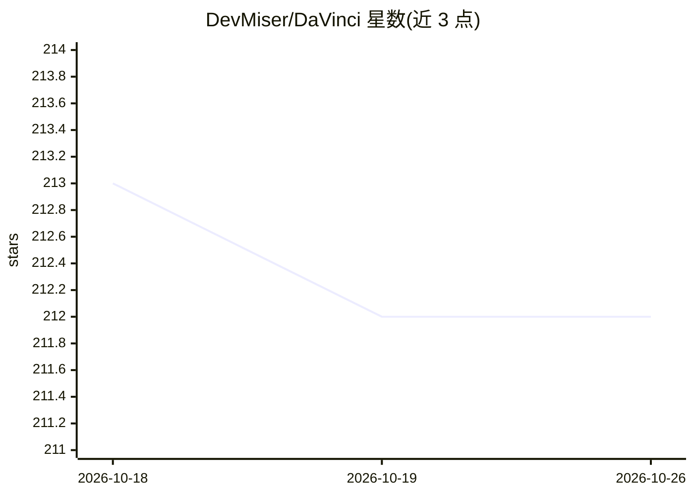

# DevMiser/DaVinci

⭐ 212 · Python · 推送 2026-10-20 · [GitHub](https://github.com/DevMiser/DaVinci) · 个人维护

**树莓派 4 语音唤醒的 GPT-Realtime 对话 AI 助手**

运行于 Raspberry Pi 4 与 USB speakerphone 的无屏语音助手：说唤醒词 "DaVinci" 后通过 OpenAI GPT-Realtime-2.1 speech-to-speech API 进行语音对话，支持内置 web 搜索、天气/时间查询、命名倒计时、音量控制和三种交互模式。唤醒词检测用 OpenWakeWord 在本地运行，天气来自 Open-Meteo。需自备 OpenAI API key（付费账户），可选 LED 显示状态。安装需在 Pi OS (Debian Trixie) 上手动装系统依赖、克隆源码、建虚拟环境并 pip 安装。

## 筛选速览

| 维度 | 判定 | 备注 |
|---|---|---|
| AI 角色 | `ai-native` | 本体是模型或模型工具 |
| 许可风险 | `none` | — |
| 部署形态 | `library` | 以包/库形式分发 |
| 模型依赖 | locked-api |  |
| 硬件要求 | — | 无带数字的原话,不猜 |
| 安装摩擦 | `low` | 无编译、无系统依赖或容器化 |
| 成熟度 | — | 结构信号不足 |

## 能力要点

- OpenAI GPT-Realtime-2.1 speech-to-speech 端到端语音对话
- OpenWakeWord 唤醒词检测全部在 Pi 本地运行（自带模型文件）
- 内置 web 搜索、Open-Meteo 七天天气、命名倒计时、三种交互模式
- 无屏运行，可选 LED（GPIO 18）指示监听/响应状态

## 适用场景

- 在树莓派上搭建免手操作的语音问答助手
- 通过语音获取时事新闻、天气与定时提醒
- DIY 智能音箱类项目（可选 3D 打印外壳）

## 场景标签

`语音 Agent` · 领域:对话与助手

## 证据(README 行号)

> L4: DaVinci is a voice-activated AI assistant that runs on a Raspberry Pi 4 with a USB speakerphone. Say the wake word *
> L8: DaVinci uses OpenWakeWord for wake-word detection, OpenAI's GPT-Realtime-2.1 API for speech-to-speech conversational

## 星数曲线

2026-10-18 213 → 2026-10-26 212（-1）

---
*卡片 v1 · prompt 1.4 · 生成 2026-10-22 · 置信度 high · 依据 README sha `99114456506d` · [字段定义](../../DATASET.md)*
