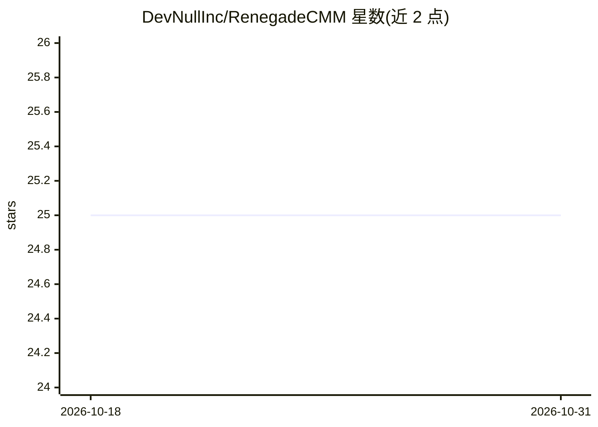

# DevNullInc/RenegadeCMM

⭐ 25 · TypeScript · NOASSERTION · 推送 2026-10-22 · [GitHub](https://github.com/DevNullInc/RenegadeCMM) · 组织维护

**管理 ComfyUI 模型文件的桌面应用：浏览下载、自动归类、版本管理**

本地桌面应用，面向 ComfyUI 用户管理生成式 AI 模型文件：从 CivitAI 与 Hugging Face Hub 双源搜索、下载并自动分拣到 ComfyUI 对应目录（checkpoints/loras/unet/gguf 等），按 GGUF 头部架构路由。提供断点续传、SHA256 校验、重复检测与合并、后台扫描、更新检测（旧版仅在下载完成且校验通过后删除）、库备份恢复 ZIP 等功能。元数据、缩略图与校验文件以伴生文件形式落盘。README 声明项目尚未功能完整，处于快速开发中。

## 筛选速览

| 维度 | 判定 | 备注 |
|---|---|---|
| AI 角色 | `ai-ecosystem` | LLM/agent 周边工具 |
| 许可风险 | `none` | NOASSERTION |
| 部署形态 | `desktop` | 安装包/桌面程序 |
| 模型依赖 | — | README 未给出锁定关系 |
| 硬件要求 | — | 无带数字的原话,不猜 |
| 安装摩擦 | `low` | 无编译、无系统依赖或容器化 |
| 成熟度 | `idea` | |

## 能力要点

- CivitAI 与 Hugging Face Hub 双源搜索下载，支持 gated 模型的 Bearer token 认证
- 零内存二进制 GGUF 头解析（仅读前 128KB）与架构自动路由
- SHA256 校验、断点续传、重复检测与更新检测（日期+哈希双重比对）
- 整库备份/恢复为 .zip，下载队列持久化到 SQLite

## 适用场景

- 在桌面端一站式浏览和下载 CivitAI / Hugging Face 模型并自动放入 ComfyUI 正确目录
- 盘点本地模型库、合并重复文件、跟踪模型更新
- 在多台机器间迁移模型库（缺失文件检测+一键按哈希补拉）

## 场景标签

 · 领域:AI 模型管理/桌面工具

## 证据(README 行号)

> L5: RenegadeCMM is a **local desktop application** for managing AI model files on your personal workstation. It does not
> L14: **The missing model manager for ComfyUI.** A unified desktop application for discovering, downloading, organizing, 
> L60: - **Auto-organizes** downloads into the correct ComfyUI folders (checkpoints → `checkpoints/`, LoRAs → `loras/`, di

## 星数曲线

2026-10-18 25 → 2026-10-31 25（+0）

---
*卡片 v1 · prompt 1.4 · 生成 2026-10-27 · 置信度 mid · 依据 README sha `57b2cffa210c` · [字段定义](../../DATASET.md)*
