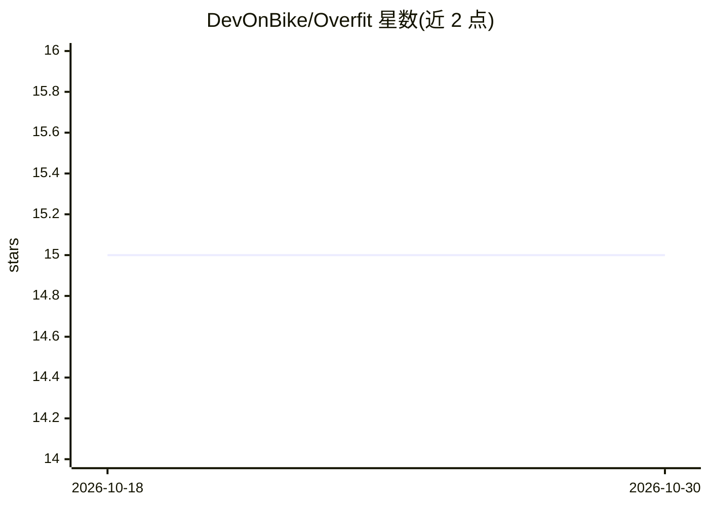

# DevOnBike/Overfit

⭐ 15 · C# · NOASSERTION · 推送 2026-10-26 · [GitHub](https://github.com/DevOnBike/Overfit) · [官网](https://overfit-ml.com) · 个人维护

**.NET 进程内 LLM 运行时：本地加载、微调与服务化，无需 Python/GPU/云**

面向 .NET 开发者的纯托管本地 AI 引擎：内存映射加载 GGUF/ONNX 模型（Qwen/Llama/Mistral/Phi/Gemma/Mixtral 等），在单一 .NET 进程内提供推理、RAG（持久化向量库）、C# 工具调用与语法约束的保证 JSON 输出、Whisper 语音转文本、CPU 上的 QLoRA 微调，并可经 `overfit serve` 提供 OpenAI 兼容 API。实现 Microsoft.Extensions.AI 的 IChatClient/IEmbeddingGenerator 接口，可接入 Semantic Kernel 等官方管线。目标场景是本地/离线/合规受限环境；声明的性能目标限于可部署性与零分配热路径，而非追赶原生 GPU 运行时吞吐。能力按 Stable/Preview/Experimental 分层标注。

## 筛选速览

| 维度 | 判定 | 备注 |
|---|---|---|
| AI 角色 | `ai-ecosystem` | LLM/agent 周边工具 |
| 许可风险 | `none` | NOASSERTION |
| 部署形态 | `desktop` | 安装包/桌面程序 |
| 模型依赖 | — | README 未给出锁定关系 |
| 硬件要求 | — | 无带数字的原话,不猜 |
| 安装摩擦 | `low` | 无编译、无系统依赖或容器化 |
| 成熟度 | `idea` | |

## 能力要点

- 进程内加载 GGUF/safetensors 模型，CPU 推理，零分配解码热路径（Roslyn 分析器 47 条规则编译期强制）
- 进程内 RAG：MiniLM/BGE/E5 嵌入 + 纯托管持久化向量文件，按内容哈希增量重嵌入
- 约束解码保证 JSON 与工具调用格式，含 MCP tools profile
- 纯 C# 实现 Whisper STT（支持 WAV/MP3，自研 MP3 解码器）与本地 TTS，CPU QLoRA 微调（Preview 层）

## 适用场景

- 在 ASP.NET/WPF/Blazor 或离线内网 .NET 产品中嵌入本地 LLM 聊天与 RAG
- 替换 Python/Ollama 侧车，用单一 .NET 进程与部署面承载本地模型
- 合规或断网环境下做可测试、可审计、答案可复现的 RAG
- 在 CPU 上用私有数据做 QLoRA 微调，无需 GPU 与 Python

## 场景标签

`推理引擎` `RAG` `语音识别` `微调` · 领域:知识与检索

## 证据(README 行号)

> L23: Overfit implements **`Microsoft.Extensions.AI`** (`IChatClient` / `IEmbeddingGenerator`), so you can drop a
> L34: 1. **Private RAG & agents inside .NET** — chat, RAG, tool-calling and schema-constrained JSON in-process; nothing l
> L48: |**Stable** — validated end-to-end, build a PoC on it|LocalAgent ASP.NET demo (chat · RAG · tools · JSON · metrics 

## 星数曲线

2026-10-18 15 → 2026-10-30 15（+0）

---
*卡片 v1 · prompt 1.4 · 生成 2026-10-30 · 置信度 mid · 依据 README sha `5a247f56a400` · [字段定义](../../DATASET.md)*
