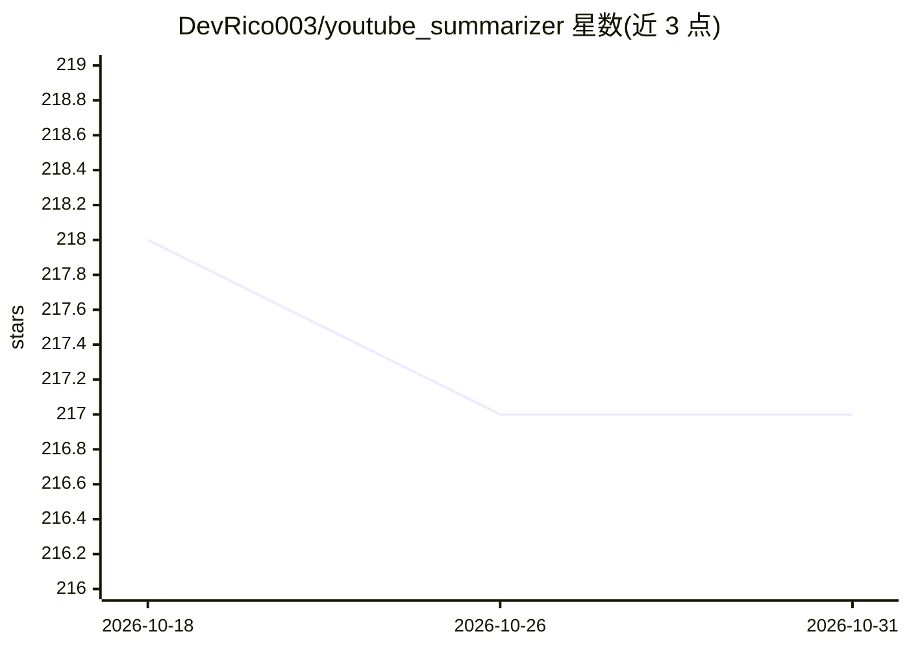

# DevRico003/youtube_summarizer

⭐ 217 · TypeScript · MIT · 推送 2026-01-29 · [GitHub](https://github.com/DevRico003/youtube_summarizer) · [官网](https://www.atmos-code.io) · 个人维护

**自托管的 YouTube 视频 AI 摘要 Web 应用（章节检测+多语言）**

基于 Next.js 16 的自托管 Web 应用：用户粘贴 YouTube 链接后，经 Supadata API 提取带时间戳的字幕，调用 Z.AI GLM-4.7 生成结构化章节摘要，支持 EN/DE/FR/ES/IT 五种输出语言，提供可点击时间戳、可视化章节时间轴、完整字幕查看与 Markdown 导出。每个用户隔离管理自己的 API 密钥，摘要按用户按视频缓存并可搜索。依赖外部服务：Supadata（字幕提取，免费层每月 100 credits）与 Z.AI 账户；README 含推荐链接披露。提供 Docker 与非 Docker 两种安装方式。

## 筛选速览

| 维度 | 判定 | 备注 |
|---|---|---|
| AI 角色 | `ai-native` | 本体是模型或模型工具 |
| 许可风险 | `permissive` | MIT |
| 部署形态 | `self-host` | docker 或自建部署 |
| 模型依赖 | — | README 未给出锁定关系 |
| 硬件要求 | — | 无带数字的原话,不猜 |
| 安装摩擦 | `low` | 无编译、无系统依赖或容器化 |
| 成熟度 | — | 结构信号不足 |

## 能力要点

- 自动章节检测与可点击时间戳跳转视频位置
- 五语言摘要输出与可视化章节时间轴
- 摘要按用户/视频缓存，历史归档可搜索
- better-auth 认证，每用户隔离管理 API 密钥

## 适用场景

- 快速了解长视频内容并按章节跳转观看
- 把视频摘要导出为 Markdown 归档
- 在自建服务器上为多用户部署视频摘要服务

## 场景标签

`AI 写作` · 领域:内容生成

## 证据(README 行号)

> L8: **AI-powered YouTube video summarization with smart chapter detection, multi-language support, and clickable timesta
> L10: Transform lengthy YouTube videos into structured, digestible summaries. YouTube Summarizer v2 automatically detects
> L118: - **LLM**: Z.AI GLM-4.7

## 星数曲线

2026-10-18 218 → 2026-10-31 217（-1）

---
*卡片 v1 · prompt 1.4 · 生成 2026-10-22 · 置信度 high · 依据 README sha `bfc7f276bbf2` · [字段定义](../../DATASET.md)*
