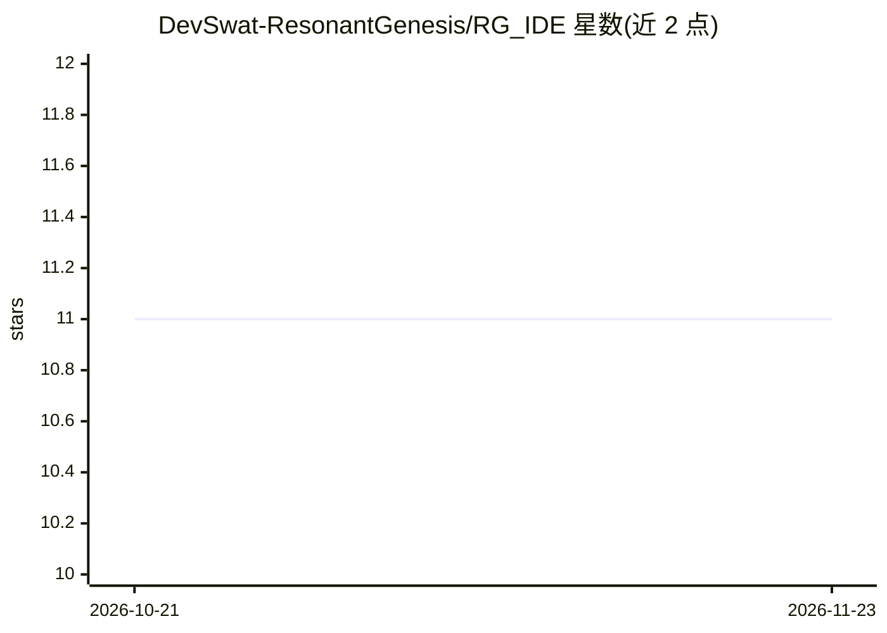

# DevSwat-ResonantGenesis/RG_IDE

⭐ 11 · TypeScript · NOASSERTION · 推送 2026-07-03 · [GitHub](https://github.com/DevSwat-ResonantGenesis/RG_IDE) · [官网](https://dev-swat.com) · 个人维护

**基于 VS Code OSS 的 AI 代码编辑器，内置代理循环与本地工具**

以 VS Code 开源版为基础构建的代码编辑器，采用客户端+服务器编排架构：Electron 客户端负责 UI、认证、本地 LLM 发现与工具执行，编排逻辑（系统提示词、工具选择、代理循环、LLM 路由）在服务端仓库 RG_Axtention_IDE 中，该仓库为私有、不含 AI 逻辑。客户端公开 59 个本地工具实现（文件、终端、Git、Notebook、部署等），云端工具经 JWT 在服务端执行，合计宣称 137+ 工具、17 类。许可为 RG Source Available。

## 筛选速览

| 维度 | 判定 | 备注 |
|---|---|---|
| AI 角色 | `ai-native` | 本体是模型或模型工具 |
| 许可风险 | `none` | NOASSERTION |
| 部署形态 | `desktop` | 安装包/桌面程序 |
| 模型依赖 | local-ok | 支持本地模型 |
| 硬件要求 | — | 无带数字的原话,不猜 |
| 安装摩擦 | `medium` | 含编译或系统依赖之一 |
| 成熟度 | — | 结构信号不足 |

## 能力要点

- 内置代理循环，本地执行 59 个工具（文件 I/O、Git、终端、Notebook、部署）
- 支持 11 个 AI 提供商 + BYOK，含 Ollama/LM Studio 本地模型发现
- AST 代码可视化工具：依赖图、死代码检测、治理审计
- Hash Sphere 跨会话持久记忆与 DSID 去中心化身份

## 适用场景

- 让 AI 代理在本地读取文件、运行命令、管理 Git 完成编码任务
- 搭配 Ollama/LM Studio 在本地运行模型驱动编辑器
- 对项目做 AST 扫描与依赖图分析

## 场景标签

`编码 Agent` · 领域:编码与开发

## 证据(README 行号)

> L14: **Resonant IDE** is a full-featured AI-native code editor built on the VS Code Open Source foundation, deeply integ
> L46: Resonant IDE uses a **thin client + server orchestration** model. The desktop app handles UI rendering, authenticat
> L85: > **Note:** Tool definitions and orchestration intelligence (system prompts, tool selection algorithm) live server-

## 星数曲线

2026-10-21 11 → 2026-11-23 11（+0）

---
*卡片 v1 · prompt 1.4 · 生成 2026-11-19 · 置信度 mid · 依据 README sha `aef8aa6a0951` · [字段定义](../../DATASET.md)*
