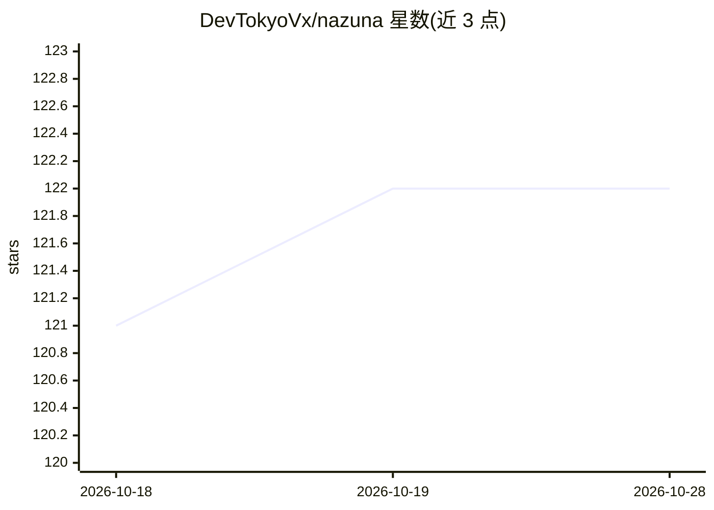

# DevTokyoVx/nazuna

⭐ 122 · JavaScript · 推送 2026-10-13 · [GitHub](https://github.com/DevTokyoVx/nazuna) · [官网](https://vexapi.com.br) · 个人维护

**基于 Baileys 的免费开源 WhatsApp 多功能聊天机器人**

用 Node.js 与 Baileys 库实现的 WhatsApp 机器人，通过 QR Code 或 Pairing Code 连接，提供命令前缀可配置、所有者（lidOwner）设置等机制。功能命令包括下载 YouTube/TikTok/Instagram/Facebook 等平台内容、去背景、生成 logo 图片、音频转文字等；其中多数命令依赖付费的 Vex API（在 vexapi.com.br 购买订阅并通过 #apikey 配置），基础功能免费。可在 Termux、Linux VPS、Pterodactyl 与 Node.js 托管环境运行。原项目由 Hiudy 创建并声明停止维护，现由 Tokyo 接手继续开发。

## 筛选速览

| 维度 | 判定 | 备注 |
|---|---|---|
| AI 角色 | `ai-native` | 本体是模型或模型工具 |
| 许可风险 | `none` | — |
| 部署形态 | `None` |  |
| 模型依赖 | — | README 未给出锁定关系 |
| 硬件要求 | — | 无带数字的原话,不猜 |
| 安装摩擦 | `low` | 无编译、无系统依赖或容器化 |
| 成熟度 | — | 结构信号不足 |

## 能力要点

- 基于 Baileys 的 WhatsApp 机器人，支持 QR Code 与 Pairing Code 两种连接方式
- 提供 YouTube/TikTok/Instagram/Facebook/Kwai/Pinterest 等多平台下载命令
- Vex API 解锁去背景、logo 生成、音频转文字（transcrever/autotranscrever）等命令
- 支持 Termux 安装，依赖首次运行自动安装

## 适用场景

- 在手机 Termux 上自建 WhatsApp 群聊机器人
- 群内下载视频/音乐/图片并做图片编辑
- 自动将群内语音消息转录为文字

## 场景标签

`聊天机器人` `语音识别` · 领域:对话与助手

## 证据(README 行号)

> L39:  v10.3.1
> L262: |📑 `autotranscrever`|Detecta áudios no grupo e transforma rapidamente em textos|

## 星数曲线

2026-10-18 121 → 2026-10-28 122（+1）

---
*卡片 v1 · prompt 1.4 · 生成 2026-10-23 · 置信度 mid · 依据 README sha `ae827487814c` · [字段定义](../../DATASET.md)*
