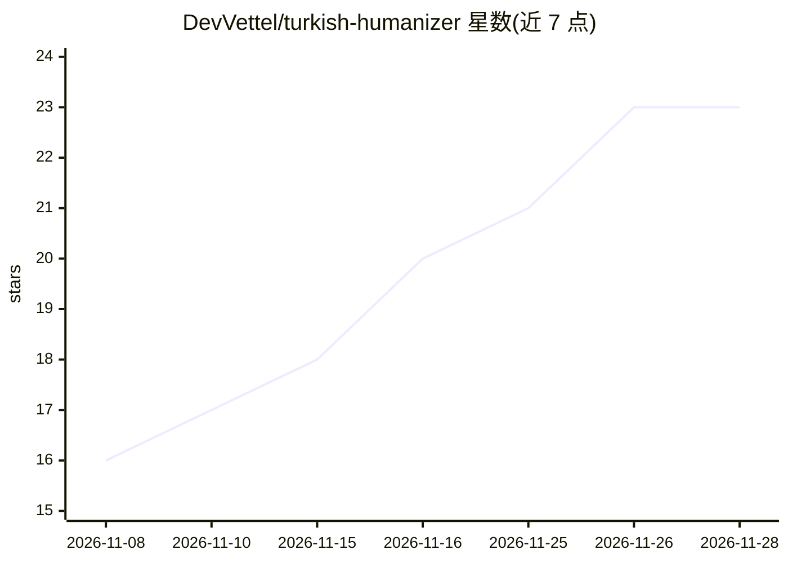

# DevVettel/turkish-humanizer

⭐ 23 · Python · MIT · 推送 2026-11-20 · [GitHub](https://github.com/DevVettel/turkish-humanizer) · 个人维护 · 中文 README

**消除土耳其语文本 AI 痕迹的 Claude 技能，兼容多家 LLM**

以 Claude Skill 形式提供的土耳其语文本改写工具：针对土耳其语中体现为句式结构的 AI 写作痕迹（句长均匀、-mektedir 动词堆叠、翻译腔习语、英文标点等）改写文本，同时保持原意、数字、术语与语域不变，也可仅输出痕迹报告而不改写。完整功能在 Claude 上运行，其他工具（ChatGPT、Gemini、Copilot、DeepSeek 等）通过单文件知识库或简短指令使用。附带纯标准库的 Python 命令行扫描器 tara.py，统计可数痕迹并核验改写后数字与专名是否保留；作者声明它不是 AI 检测器。

## 筛选速览

| 维度 | 判定 | 备注 |
|---|---|---|
| AI 角色 | `ai-native` | 本体是模型或模型工具 |
| 许可风险 | `permissive` | MIT |
| 部署形态 | `None` |  |
| 模型依赖 | locked-api |  |
| 硬件要求 | — | 无带数字的原话,不猜 |
| 安装摩擦 | `low` | 无编译、无系统依赖或容器化 |
| 成熟度 | — | 结构信号不足 |

## 能力要点

- 面向土耳其语结构特征的 AI 痕迹目录与改写规则
- 保持语义、数字、术语与语域不变的改写模式
- 附带 tara.py 扫描器：统计痕迹分布并对比改写前后
- 提供 Claude Skill 包与其他 LLM 的单文件接入方式

## 适用场景

- 把 AI 生成的土耳其语文本改写得更自然
- 发布前检查文本中的 AI 写作痕迹
- 核验改写后数字、专名与缓和表述是否保留

## 场景标签

`AI 写作` · 领域:内容生成

## 证据(README 行号)

> L3: Türkçe metinleri yapay zeka izlerinden arındıran bir Claude skill'i.
> L195: **turkish-humanizer** is a Claude skill that removes AI-writing patterns from Turkish text.
> L199: The skill rewrites the text while preserving meaning, numbers, terminology and proper nouns exactly, and it keeps 

## 星数曲线

2026-11-08 16 → 2026-11-28 23（+7）

---
*卡片 v1 · prompt 1.4 · 生成 2026-11-18 · 置信度 high · 依据 README sha `821ea0b3cbb7` · [字段定义](../../DATASET.md)*
