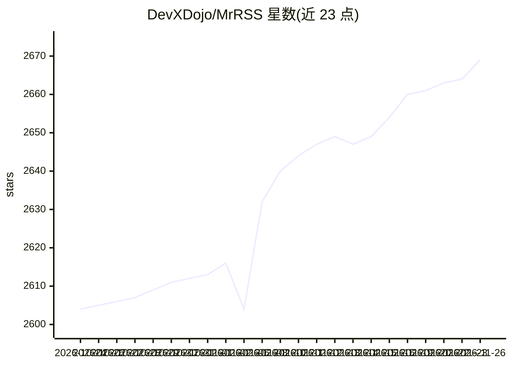

# DevXDojo/MrRSS

⭐ 2,669 · Go · GPL-3.0 · 推送 2026-11-22 · [GitHub](https://github.com/DevXDojo/MrRSS) · [官网](https://mrrss.ch3nyang.top/) · 组织维护 · 中文 README

**面向个人用户的跨平台 AI RSS 阅读器，支持翻译与摘要**

基于 Go/Wails v3 与 Vue.js 构建的桌面 RSS 阅读器，支持 Windows/macOS/Linux 三平台。核心功能：自动翻译文章标题与内容、生成摘要、AI 推荐，并可通过技能（skills）读取和操作；订阅方式覆盖 URL、XPath、脚本、newsletter 等类型；提供插件生态对接 Obsidian、Notion、FreshRSS、RSSHub；内置过滤器与脚本系统实现自动化工作流。分发形式包括预构建安装包、便携版、源码构建以及 headless server 的 Docker 镜像（REST API 限定本机访问）。

## 筛选速览

| 维度 | 判定 | 备注 |
|---|---|---|
| AI 角色 | `ai-enhanced` | 去掉 AI 部分产品仍成立 |
| 许可风险 | `viral` | GPL-3.0 |
| 部署形态 | `desktop` | 安装包/桌面程序 |
| 模型依赖 | — | README 未给出锁定关系 |
| 硬件要求 | — | 无带数字的原话,不猜 |
| 安装摩擦 | `low` | 无编译、无系统依赖或容器化 |
| 成熟度 | — | 结构信号不足 |

## 能力要点

- 自动翻译文章标题与内容并生成摘要
- 提供 Codex 技能包，可通过 API 由 AI agent 操作
- 订阅方式支持 URL、XPath、脚本、newsletter
- 桌面应用与 headless server 双形态，后者提供 Docker 镜像

## 适用场景

- 在桌面端聚合和管理多来源 RSS 订阅
- 用 AI 翻译外文文章并生成摘要快速获取信息
- 将文章通过插件同步到 Obsidian/Notion 等工具
- 部署 server 版本通过 API 集成阅读数据

## 场景标签

 · 领域:信息聚合/阅读工具

## 证据(README 行号)

> L17: - 🌐 **Auto-Translation & Summarization**: Automatically translate article titles and content, and generate concise 
> L18: - 🤖 **AI-Enhanced Features**: Integrated advanced AI technology for translation, summarization, recommendations, an
> L20: - 📡 **Diverse Subscription Methods**: Supports URL, XPath, scripts, newsletters, and other feed types to meet diffe

## 星数曲线

2026-10-24 2,604 → 2026-11-26 2,669（+65）

---
*卡片 v1 · prompt 1.4 · 生成 2026-11-24 · 置信度 high · 依据 README sha `05c1b958f947` · [字段定义](../../DATASET.md)*
