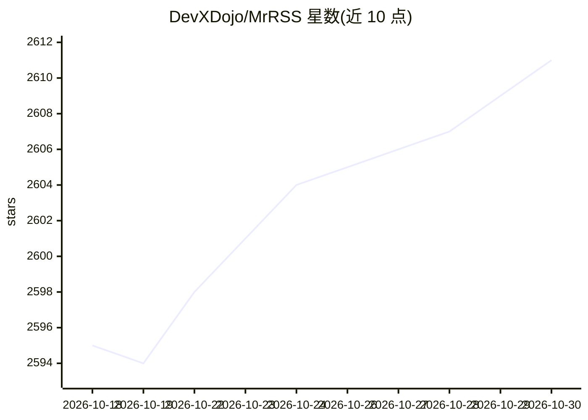

# DevXDojo/MrRSS

⭐ 2,611 · Go · GPL-3.0 · 推送 2026-10-26 · [GitHub](https://github.com/DevXDojo/MrRSS) · [官网](https://mrrss.ch3nyang.top/) · 组织维护 · 中文 README

**带 AI 翻译与摘要的跨平台桌面 RSS 阅读器**

基于 Go + Wails + Vue.js 的跨平台 RSS 阅读器，支持订阅 URL、XPath、脚本、newsletter 等多种信源，内置过滤与脚本系统实现自动化工作流。AI 部分提供文章自动翻译、摘要生成与推荐，并支持通过技能（skills）让 Codex 等 agent 经本地 REST API 操作阅读器。插件生态可对接 Obsidian、Notion、FreshRSS、RSSHub。提供 Windows/macOS/Linux 安装包与便携版，另有 Docker 部署的无头服务器版。GPL-3.0 许可。

## 筛选速览

| 维度 | 判定 | 备注 |
|---|---|---|
| AI 角色 | `ai-enhanced` | 去掉 AI 部分产品仍成立 |
| 许可风险 | `viral` | GPL-3.0 |
| 部署形态 | `desktop` | 安装包/桌面程序 |
| 模型依赖 | — | README 未给出锁定关系 |
| 硬件要求 | — | 无带数字的原话,不猜 |
| 安装摩擦 | `low` | 无编译、无系统依赖或容器化 |
| 成熟度 | — | 结构信号不足 |

## 能力要点

- 文章标题与内容自动翻译并生成摘要
- 支持 URL/XPath/脚本/newsletter 等多种订阅方式
- 集成 Obsidian、Notion、FreshRSS、RSSHub 插件生态
- 桌面版内置本地 REST API，可被 Codex 等 agent 通过技能包操作

## 适用场景

- 订阅并阅读多来源 RSS 信息流，AI 辅助翻译和摘要
- 通过过滤器和自定义脚本实现订阅自动化
- 用 Docker 部署服务器版供浏览器访问与 API 集成

## 场景标签

 · 领域:信息聚合/桌面应用

## 证据(README 行号)

> L17: - 🌐 **Auto-Translation & Summarization**: Automatically translate article titles and content, and generate concise 
> L18: - 🤖 **AI-Enhanced Features**: Integrated advanced AI technology for translation, summarization, recommendations, an

## 星数曲线

2026-10-18 2,595 → 2026-10-30 2,611（+16）

---
*卡片 v1 · prompt 1.4 · 生成 2026-10-21 · 置信度 mid · 依据 README sha `7f9cd1bb6d05` · [字段定义](../../DATASET.md)*
