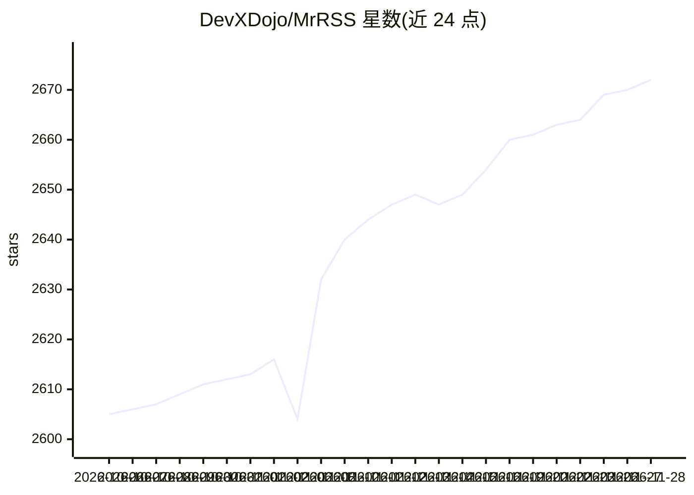

# DevXDojo/MrRSS

⭐ 2,672 · Go · GPL-3.0 · 推送 2026-11-27 · [GitHub](https://github.com/DevXDojo/MrRSS) · [官网](https://mrrss.ch3nyang.top/) · 组织维护 · 中文 README

**跨平台 AI RSS 阅读器：订阅、翻译、摘要与自动化**

用 Go + Wails + Vue.js 构建的跨平台 RSS/Atom 阅读器，Windows/macOS/Linux 提供安装包与便携版。核心功能包括订阅源管理（URL、XPath、脚本、邮件等多种订阅方式）、文章标题与内容的自动翻译和摘要生成、推荐、内置过滤与脚本自动化系统，以及与 Obsidian、Notion、FreshRSS、RSSHub 的集成。另提供 REST API 的本地接口与可 Docker 部署的无头服务器版本，支持 Codex 通过技能包操作本产品。

## 筛选速览

| 维度 | 判定 | 备注 |
|---|---|---|
| AI 角色 | `ai-enhanced` | 去掉 AI 部分产品仍成立 |
| 许可风险 | `viral` | GPL-3.0 |
| 部署形态 | `desktop` | 安装包/桌面程序 |
| 模型依赖 | — | README 未给出锁定关系 |
| 硬件要求 | — | 无带数字的原话,不猜 |
| 安装摩擦 | `low` | 无编译、无系统依赖或容器化 |
| 成熟度 | — | 结构信号不足 |

## 能力要点

- 自动翻译文章标题与内容并生成摘要
- 支持 URL、XPath、脚本、Newsletter 等多种订阅方式
- 内置过滤器与脚本系统，支持自动化工作流
- 提供本地 REST API 与 Docker 无头服务器版

## 适用场景

- 聚合管理多个 RSS/Atom 订阅源并快速浏览
- 外文订阅源的自动翻译阅读
- 通过脚本和过滤器自动处理文章并存入 Obsidian/Notion
- 在服务器上以无头模式部署并通过 API 集成

## 场景标签

`工作流自动化` · 领域:效率与自动化

## 证据(README 行号)

> L17: - 🌐 **Auto-Translation & Summarization**: Automatically translate article titles and content, and generate concise 
> L18: - 🤖 **AI-Enhanced Features**: Integrated advanced AI technology for translation, summarization, recommendations, an
> L20: - 📡 **Diverse Subscription Methods**: Supports URL, XPath, scripts, newsletters, and other feed types to meet diffe

## 星数曲线

2026-10-26 2,605 → 2026-11-28 2,672（+67）

---
*卡片 v1 · prompt 1.4 · 生成 2026-11-28 · 置信度 high · 依据 README sha `83bcfc1830ba` · [字段定义](../../DATASET.md)*
