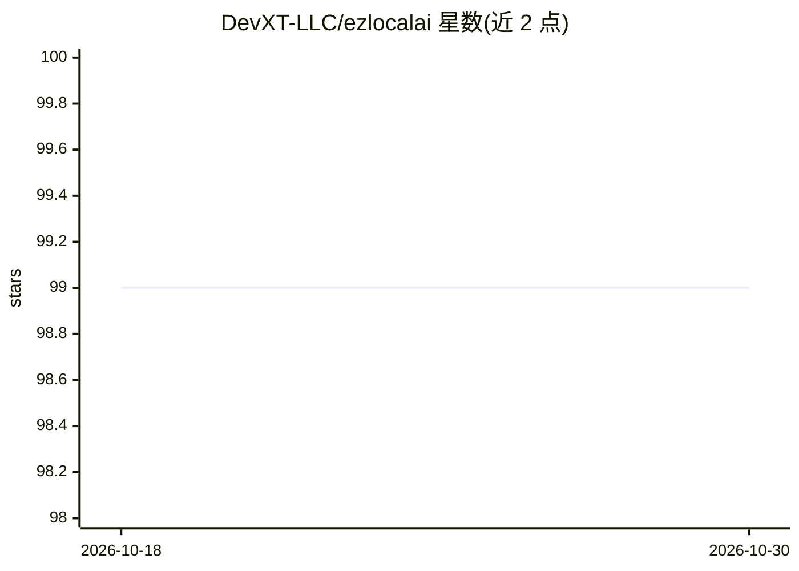

# DevXT-LLC/ezlocalai

⭐ 99 · C++ · MIT · 推送 2026-10-29 · [GitHub](https://github.com/DevXT-LLC/ezlocalai) · 组织维护

**C++17 本地 AI 推理服务器，提供 OpenAI 兼容接口**

用 C++17 重写的本地 AI 推理服务器，通过原生 llama.cpp 运行本地 LLM 与嵌入推理，对外提供 OpenAI 兼容 HTTP API，覆盖 chat/视觉、嵌入、语音转文字（Whisper）、文字转语音（Qwen TTS）、图像/音乐/视频生成与唤醒词训练。配合独立 Rust WorkerRouter 做机群路由，含与 Python 版对照的 parity 校验门。提供 CPU 与 CUDA 两种 Docker 镜像及源码 CMake 构建；限制包括物理多 GPU 验证、视频质量验收等仍在进行。

## 筛选速览

| 维度 | 判定 | 备注 |
|---|---|---|
| AI 角色 | `ai-ecosystem` | LLM/agent 周边工具 |
| 许可风险 | `permissive` | MIT |
| 部署形态 | `self-host` | docker 或自建部署 |
| 模型依赖 | local-ok | 支持本地模型 |
| 硬件要求 | `cpu-ok` | |
| 安装摩擦 | `low` | 无编译、无系统依赖或容器化 |
| 成熟度 | — | 结构信号不足 |

## 能力要点

- llama.cpp 原生本地 LLM/嵌入推理，OpenAI 兼容 API
- Whisper STT、Qwen TTS、stable-diffusion.cpp 图像生成、唤醒词训练
- CPU 与 CUDA 两套 Docker Compose 部署，七个持久化挂载
- 与 Python 参考实现对照的 parity_manifest 强制校验工具

## 适用场景

- 本地部署一套 OpenAI 风格的多模态推理服务
- 在 CUDA 或纯 CPU 环境运行 LLM、语音、图像生成工作负载
- 用 WorkerRouter 组成多 worker 推理机群

## 场景标签

`推理引擎` `语音识别` `语音合成` `图像生成` · 领域:内容生成

## 证据(README 行号)

> L3: ezlocalai is a local AI inference server with an OpenAI-compatible HTTP API:

## 星数曲线

2026-10-18 99 → 2026-10-30 99（+0）

---
*卡片 v1 · prompt 1.4 · 生成 2026-10-23 · 置信度 high · 依据 README sha `db58e68ac1f8` · [字段定义](../../DATASET.md)*
