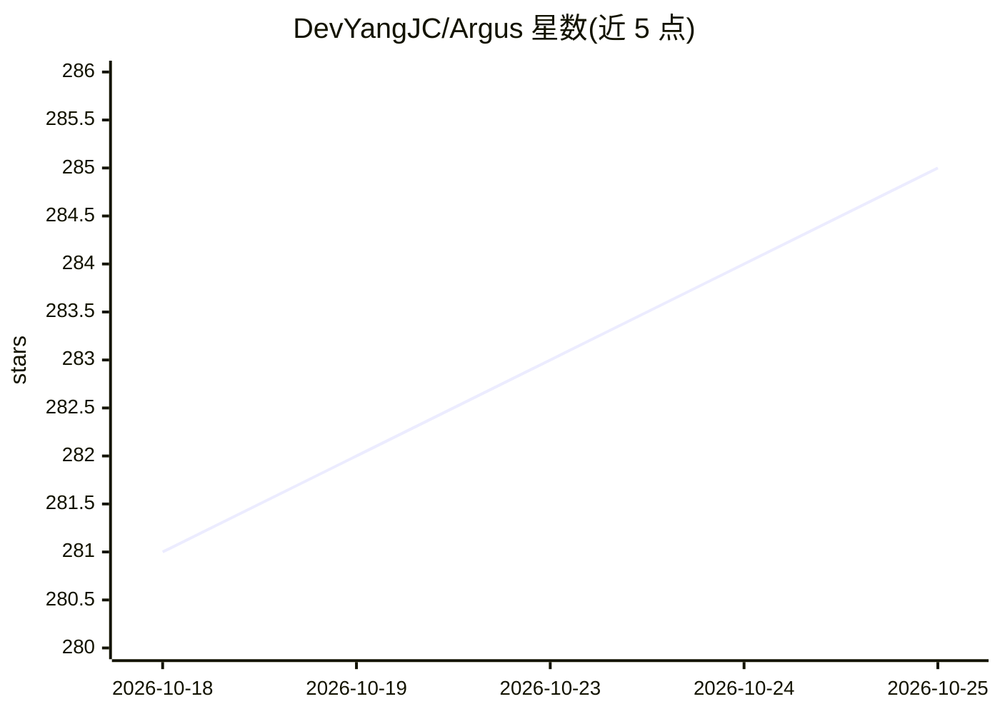

# DevYangJC/Argus

⭐ 285 · Java · 推送 2026-08-16 · [GitHub](https://github.com/DevYangJC/Argus) · 组织维护 · 中文 README

**面向企业的 RAG + AI Agent 开源知识库问答平台**

基于 Java 21 + Spring Boot 3.5 与 Vue 3 的 RAG 知识库平台：文档上传（PDF/DOCX/MD/TXT）后经 ETL 流水线解析、切片、向量化，采用 pgvector HNSW 语义检索与 Elasticsearch IK 关键词检索双通道，RRF 融合排序，四级证据评估不足时拒答，回答附带引用溯源。AI 层基于 Spring AI Alibaba（DashScope 通义千问），ReactAgent 图引擎支持 CHAT/KB_SEARCH 双模式与三级短期记忆压缩。需自建 PostgreSQL/pgvector、Elasticsearch、MinIO 等中间件并配置 DashScope API Key，从源码构建启动。

## 筛选速览

| 维度 | 判定 | 备注 |
|---|---|---|
| AI 角色 | `ai-native` | 本体是模型或模型工具 |
| 许可风险 | `permissive` | — |
| 部署形态 | `self-host` | docker 或自建部署 |
| 模型依赖 | — | README 未给出锁定关系 |
| 硬件要求 | — | 无带数字的原话,不猜 |
| 安装摩擦 | `low` | 无编译、无系统依赖或容器化 |
| 成熟度 | — | 结构信号不足 |

## 能力要点

- 向量 + 关键词双通道混合检索与 RRF 融合排序
- 四级证据评估（NONE→WEAK→PARTIAL→SUFFICIENT），证据不足主动拒答
- ReactAgent 图引擎，CHAT/KB_SEARCH 双模式与三级短期记忆压缩
- 三级角色权限、JWT 双令牌、群组数据隔离的安全体系

## 适用场景

- 企业私有文档的统一知识库问答与引用溯源
- 团队群组协作管理共享知识库并控制权限
- 在同一会话中切换纯对话与知识库检索模式

## 场景标签

`文档问答` `RAG` · 领域:知识与检索

## 证据(README 行号)

> L14:  融合 RAG 与 AI Agent 技术的企业级智能知识平台
> L30: **Argus** 不是另一个"套壳 ChatGPT"。它是一个从底层构建的 **RAG（检索增强生成）知识库平台**，将企业私有文档与大语言模型深度融合，解决 LLM 在垂直领域应用中的三大核心痛点：
> L132: |AI Chat|**Spring AI Alibaba**|1.1.2.0|DashScope 原生集成（通义千问）|

## 星数曲线

2026-10-18 281 → 2026-10-25 285（+4）

---
*卡片 v1 · prompt 1.4 · 生成 2026-10-22 · 置信度 mid · 依据 README sha `ef4ccc579c1c` · [字段定义](../../DATASET.md)*
