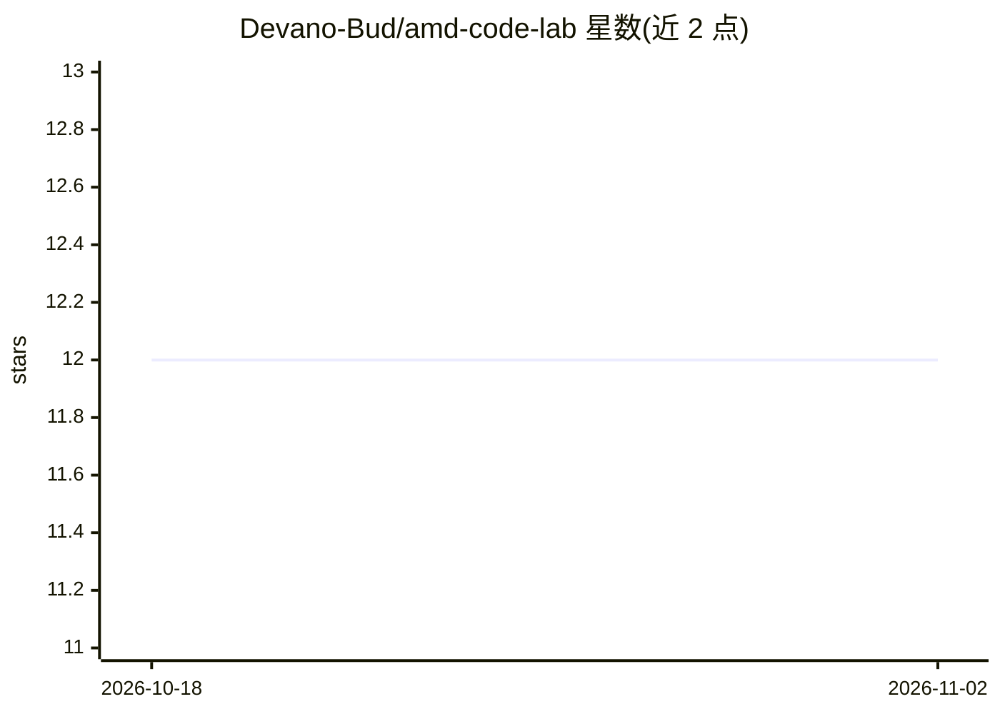

# Devano-Bud/amd-code-lab

⭐ 12 · Python · MIT · 推送 2026-07-08 · [GitHub](https://github.com/Devano-Bud/amd-code-lab) · 个人维护

**在 AMD GPU 上进行代码生成与分析的 LLM 实验仓库**

围绕 AMD GPU（ROCm）环境的代码生成与分析实验集合，主题标签涉及 LLM 与 LoRA 微调。README 记录了硬件测试情况（AMD RX 7800 XT 与 RX 7900 XTX，RDNA3 架构）、批处理性能改进、错误信息优化，以及 OOM 排查建议（减小 batch size 或启用 gradient checkpointing）。README 可见部分未给出安装或运行命令，具体实验内容与目录结构需查阅仓库源文件。

## 筛选速览

| 维度 | 判定 | 备注 |
|---|---|---|
| AI 角色 | `ai-ecosystem` | LLM/agent 周边工具 |
| 许可风险 | `permissive` | MIT |
| 部署形态 | `None` |  |
| 模型依赖 | — | README 未给出锁定关系 |
| 硬件要求 | — | 无带数字的原话,不猜 |
| 安装摩擦 | `low` | 无编译、无系统依赖或容器化 |
| 成熟度 | — | 结构信号不足 |

## 能力要点

- 在 AMD RX 7800 XT / 7900 XTX（RDNA3）上测试
- 含 OOM 排查指引（减小 batch size / gradient checkpointing）
- 批处理性能改进与错误信息优化

## 适用场景

- 在 AMD ROCm 环境下复现代码生成/LoRA 相关实验
- 参考 AMD 消费级 GPU 上跑 LLM 的硬件兼容信息

## 场景标签

`代码生成` `微调` · 领域:编码与开发

## 证据(README 行号)

> L13: ## Hardware Tested
> L14: - AMD RX 7800 XT (RDNA3)

## 星数曲线

2026-10-18 12 → 2026-11-02 12（+0）

---
*卡片 v1 · prompt 1.4 · 生成 2026-11-01 · 置信度 low · 依据 README sha `91e28f11994b` · [字段定义](../../DATASET.md)*
