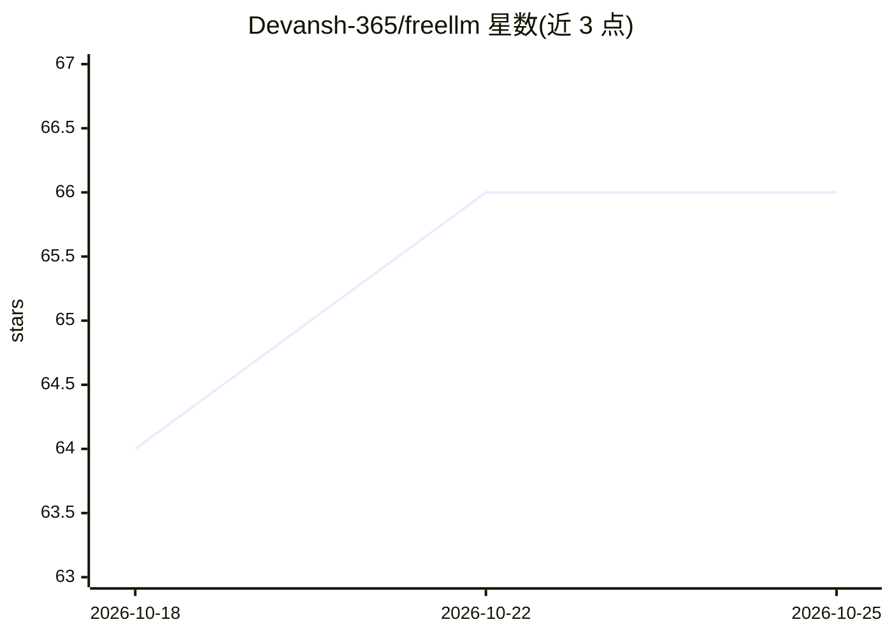

# Devansh-365/freellm

⭐ 66 · TypeScript · MIT · 推送 2026-05-29 · [GitHub](https://github.com/Devansh-365/freellm) · [官网](https://freellms.vercel.app) · 个人维护

**聚合 8 家免费 LLM 提供商的 OpenAI 兼容网关，带自动故障转移**

TypeScript 实现的 OpenAI 兼容 API 网关，将 Groq、Gemini、Mistral、Cerebras、NVIDIA NIM、Cloudflare Workers AI、GitHub Models 与 Ollama 八家提供商的路由聚合到单一端点：提供三种元模型策略、多密钥轮换、响应缓存、熔断器与实时仪表盘。支持虚拟子密钥、按用户限流、浏览器短时 HMAC 令牌与隐私路由（按训练政策筛选提供商）。可通过 Docker、Railway/Render 一键部署或源码运行，面向希望在免费额度内调用 LLM 的开发者。

## 筛选速览

| 维度 | 判定 | 备注 |
|---|---|---|
| AI 角色 | `ai-ecosystem` | LLM/agent 周边工具 |
| 许可风险 | `permissive` | MIT |
| 部署形态 | `self-host` | docker 或自建部署 |
| 模型依赖 | local-ok | 支持本地模型 |
| 硬件要求 | — | 无带数字的原话,不猜 |
| 安装摩擦 | `low` | 无编译、无系统依赖或容器化 |
| 成熟度 | — | 结构信号不足 |

## 能力要点

- 8 家提供商统一为 OpenAI 兼容端点，自动故障转移与熔断器
- 三种元模型策略（free / free-fast / free-smart）按需路由
- 多密钥轮换叠加免费额度，响应缓存重复提示约 23ms 返回
- 虚拟子密钥、按标识符限流与浏览器短时 HMAC 令牌支持多租户

## 适用场景

- 在免费额度内做提示词测试与应用原型开发
- 用任意 OpenAI SDK 换 base URL 即接入，无需改代码
- 把网关安全暴露给静态站点的终端用户聊天场景

## 场景标签

`模型网关` · 领域:Agent 开发

## 证据(README 行号)

> L15: FreeLLM is an OpenAI-compatible gateway that routes across Groq, Gemini, Mistral, Cerebras, NVIDIA NIM, Cloudflare 
> L50: - **Drop-in OpenAI SDK.** Swap your base URL. Keep your code.

## 星数曲线

2026-10-18 64 → 2026-10-25 66（+2）

---
*卡片 v1 · prompt 1.4 · 生成 2026-10-24 · 置信度 mid · 依据 README sha `acb5b8e675fd` · [字段定义](../../DATASET.md)*
