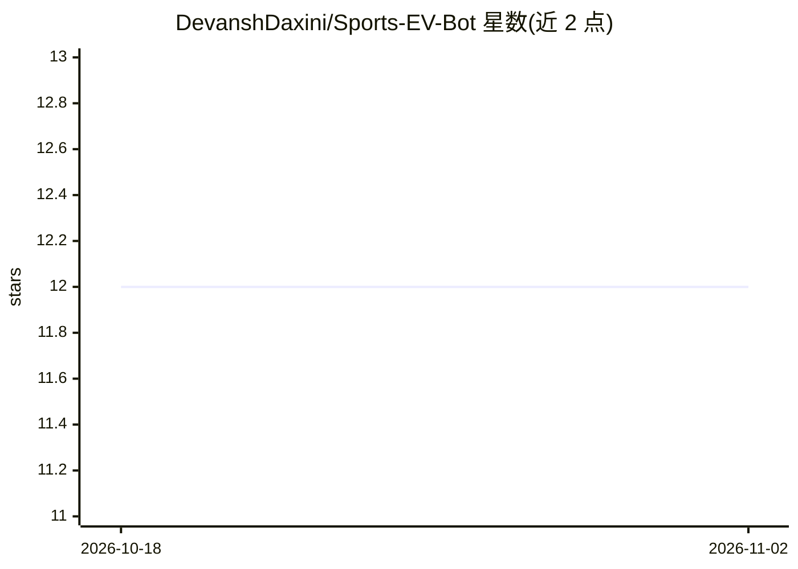

# DevanshDaxini/Sports-EV-Bot

⭐ 12 · Python · 推送 2026-05-26 · [GitHub](https://github.com/DevanshDaxini/Sports-EV-Bot) · 个人维护

**多运动球员道具博彩分析引擎：XGBoost 预测对比盘口找正 EV 机会**

面向 NBA 与网球的 prop betting 分析工具：三层分析可单独或组合使用。AI Scanner 用 XGBoost+LightGBM 集成模型（NBA 451 特征、网球 150+ 特征）预测球员数据线；Odds Scanner 通过 the-odds-api 拉取 FanDuel 赔率并去水计算隐含概率，与 PrizePicks 盘口对数缩放比较；Super Scanner 仅在两信号同向时输出。本地训练模型（NBA 约 10 分钟），需 ODDS_API_KEY，命令行菜单交互。

## 筛选速览

| 维度 | 判定 | 备注 |
|---|---|---|
| AI 角色 | `ai-native` | 本体是模型或模型工具 |
| 许可风险 | `none` | — |
| 部署形态 | `library` | 以包/库形式分发 |
| 模型依赖 | — | README 未给出锁定关系 |
| 硬件要求 | — | 无带数字的原话,不猜 |
| 安装摩擦 | `low` | 无编译、无系统依赖或容器化 |
| 成熟度 | — | 结构信号不足 |

## 能力要点

- 21 个 NBA + 7 个网球 XGBoost/LightGBM 预测模型，含 Optuna 贝叶斯调参与防泄漏特征
- FanDuel 去水隐含概率与 PrizePicks 盘口对数缩放比对
- Super Scanner 仅输出数学赔率与 AI 预测同向的机会
- 球员侦察报告含替代盘口（goblin/demon）标注

## 适用场景

- 我想跑模型预测 NBA 球员数据线并与 PrizePicks 盘口比对
- 我想比较 FanDuel 与 PrizePicks 的赔率差异找正 EV 机会
- 我想本地训练并查看网球比赛数据模型预测

## 场景标签

 · 领域:体育数据分析/博彩

## 证据(README 行号)

> L3: A multi-sport prop betting analysis engine. Uses XGBoost + LightGBM ensemble models trained on historical data to pr
> L13: Trains XGBoost + LightGBM ensemble models on historical player data to predict stat lines. For NBA, uses nba_api ga

## 星数曲线

2026-10-18 12 → 2026-11-02 12（+0）

---
*卡片 v1 · prompt 1.4 · 生成 2026-11-01 · 置信度 mid · 依据 README sha `142c3da46e6f` · [字段定义](../../DATASET.md)*
