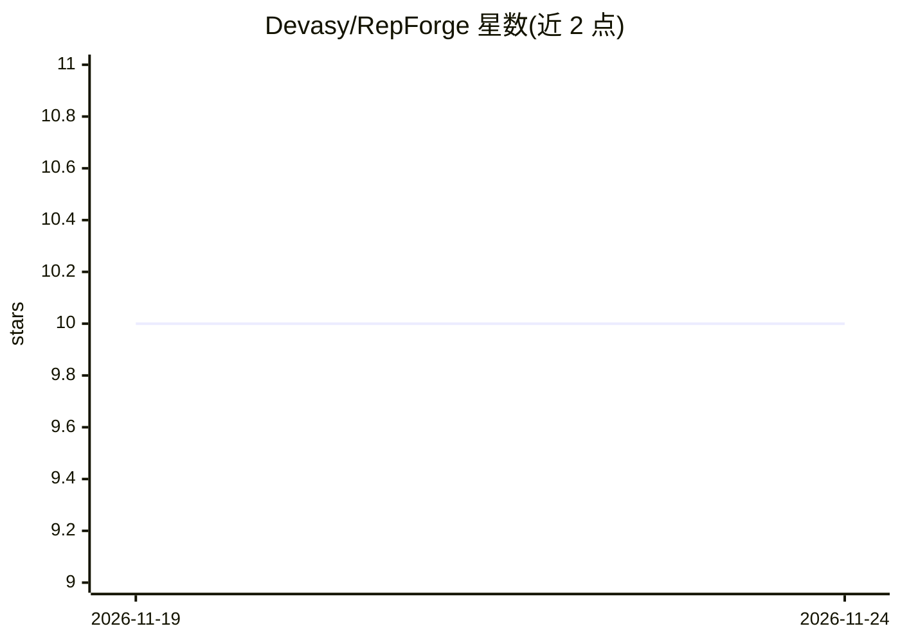

# Devasy/RepForge

⭐ 10 · Dart · Apache-2.0 · 推送 2026-11-14 · [GitHub](https://github.com/Devasy/RepForge) · 个人维护

**开源 Android 健身记录应用，可选接入 Gemini AI 教练分析训练数据**

基于 Flutter 的开源 Android 健身日志应用，支持离线记录组数/重量/休息、例行计划、多周训练程序、估计 1RM 与肌肉群训练量分析，可连接 Android Health Connect 获取睡眠和心率数据。可选的 Gemini AI 教练通过只读、限定范围的 schema-aware SQL 检索本地训练记录，生成解释、图表与训练计划（写入需显式批准）；AI 功能需用户自备 API key。仓库同时提供可复用的 Dart agent 编排包（未发布 pub.dev，仅本地 path 依赖）与 GenUI 生成界面模块。

## 筛选速览

| 维度 | 判定 | 备注 |
|---|---|---|
| AI 角色 | `ai-enhanced` | 去掉 AI 部分产品仍成立 |
| 许可风险 | `permissive` | Apache-2.0 |
| 部署形态 | `None` |  |
| 模型依赖 | — | README 未给出锁定关系 |
| 硬件要求 | — | 无带数字的原话,不猜 |
| 安装摩擦 | `low` | 无编译、无系统依赖或容器化 |
| 成熟度 | — | 结构信号不足 |

## 能力要点

- 离线优先：记录、例行与分析无需账号即可本地使用
- Gemini 教练以只读、限流的 schema-aware SQL 查询本地训练数据，支持图表等结构化输出
- 可复用四个私有 Dart 编排包：模型/工具循环、SQLite 检查点、Flutter 集成、Gemini 适配器
- GenUI 模块将模型输出的 JSON 渲染为本地注册组件（图表/卡片等），不执行模型生成的 Dart

## 适用场景

- 离线记录健身房训练并追踪进步与个人记录
- 向 AI 教练提问自己三个月内的深蹲进展等趋势问题
- 把 agent 编排或生成式 UI 模块复用到其他 Flutter 应用
- 通过 Health Connect 将睡眠/心率数据与训练结合查看

## 场景标签

`数据分析` · 领域:效率与自动化

## 证据(README 行号)

> L18: RepForge helps you record what you did, see what changed, and decide what to do next. Log a gym session, follow a r
> L26: |Understand your own records|Ask the optional Gemini coach to retrieve training history, investigate a trend, and p
> L141: Workout logging, routines, and standard analytics work locally. The optional AI coach and AI planning features sen

## 星数曲线

2026-11-19 10 → 2026-11-24 10（+0）

---
*卡片 v1 · prompt 1.4 · 生成 2026-11-20 · 置信度 high · 依据 README sha `6e7bc17ea5d7` · [字段定义](../../DATASET.md)*
