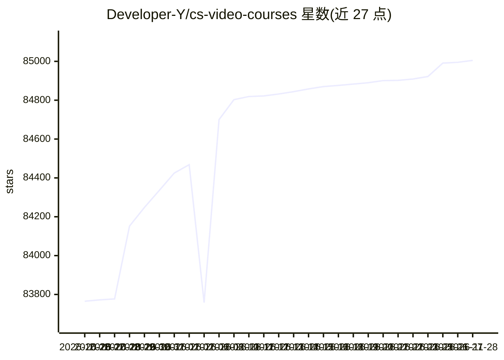

# Developer-Y/cs-video-courses

⭐ 85,005 · 推送 2026-11-24 · [GitHub](https://github.com/Developer-Y/cs-video-courses) · 个人维护

**面向学习者的高校计算机课程视频讲座汇总清单**

以清单形式汇总大学级别的计算机科学公开课程及其视频链接，按导论、数据结构与算法、系统编程、操作系统等类别组织；收录 MIT OCW、Stanford、UC Berkeley、CMU、IIT 等机构的课程条目，部分条目附课程网站、讲义、作业与考试资料链接。通过 CONTRIBUTING.md 接受社区 PR 贡献，明确排除 MOOC、基础教程与广告类链接。

## 筛选速览

| 维度 | 判定 | 备注 |
|---|---|---|
| AI 角色 | `ai-knowledge` | 知识聚合/清单类 |
| 许可风险 | `none` | — |
| 部署形态 | `None` |  |
| 模型依赖 | — | README 未给出锁定关系 |
| 硬件要求 | — | 无带数字的原话,不猜 |
| 安装摩擦 | `medium` | 含编译或系统依赖之一 |
| 成熟度 | — | 结构信号不足 |

## 动量与使用信号

- 维护:`active` — 距上次 push 3.8 天,年发版 0,117 位贡献者
- 涨星:近 1 天 **+9**(自 20261016 起算)
- 安装:github 包 `release-assets` 月下载无数据

## 能力要点

- 按学科类别组织的高校课程视频讲座索引
- 部分课程附课程网站、作业、实验与考试资料链接
- 通过 PR 机制接受社区贡献并维护收录标准

## 适用场景

- 按主题查找某门计算机课程的完整视频讲座
- 自学时对比不同大学的同一学科课程
- 为教学或备课收集公开课资源链接

## 场景标签

`精选清单` · 领域:学习与行业

## 证据(README 行号)

> L1: # Computer Science courses with video lectures
> L8: - You are welcome to contribute, please create PR for actual college/University level courses. Please do not add lin
> L14: ## Courses

## 星数曲线

2026-10-26 83,765 → 2026-11-28 85,005（+1,240）

---
*卡片 v1 · prompt 1.4 · 生成 2026-11-26 · 置信度 high · 依据 README sha `9ead7e82f33c` · [字段定义](../../DATASET.md)*
