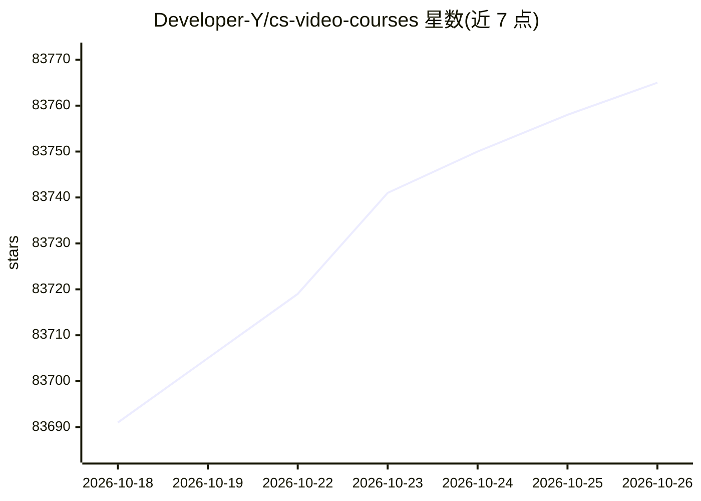

# Developer-Y/cs-video-courses

⭐ 83,765 · 推送 2026-10-24 · [GitHub](https://github.com/Developer-Y/cs-video-courses) · 个人维护

**计算机科学视频公开课课程清单（含算法/系统/机器学习等）**

由个人维护的计算机科学课程链接清单：按导论、数据结构与算法、系统编程、操作系统等章节组织，收录 MIT、Stanford、CMU、UC Berkeley、IIT 等高校的正式大学课程视频与配套材料（讲义、作业、考试），主题标签还覆盖机器学习、深度学习、计算机视觉、生物信息学、计算物理、数据库、嵌入式系统等。README 明确声明只收录大学水平课程，不收小型 MOOC、基础教程或广告链接；以 Markdown 清单形式提供，无软件可安装运行。

## 筛选速览

| 维度 | 判定 | 备注 |
|---|---|---|
| AI 角色 | `ai-knowledge` | 知识聚合/清单类 |
| 许可风险 | `none` | — |
| 部署形态 | `None` |  |
| 模型依赖 | — | README 未给出锁定关系 |
| 硬件要求 | — | 无带数字的原话,不猜 |
| 安装摩擦 | `medium` | 含编译或系统依赖之一 |
| 成熟度 | — | 结构信号不足 |

## 动量与使用信号

- 维护:`active` — 距上次 push 3.8 天,年发版 0,117 位贡献者
- 涨星:近 1 天 **+9**(自 20261016 起算)
- 安装:github 包 `release-assets` 月下载无数据

## 能力要点

- 按学科章节组织的大学视频课程链接清单
- 覆盖算法、系统、机器学习、计算机视觉、生物信息学等主题
- 明确收录标准：仅限大学/学院水平课程

## 适用场景

- 按主题系统性地自学计算机科学课程
- 查找某门课（如 MIT 6.006、CMU 15-213）的视频与配套材料

## 场景标签

`教程课程` `精选清单` · 领域:学习与行业

## 证据(README 行号)

> L1: # Computer Science courses with video lectures
> L14: ## Courses

## 星数曲线

2026-10-18 83,691 → 2026-10-26 83,765（+74）

---
*卡片 v1 · prompt 1.4 · 生成 2026-10-20 · 置信度 high · 依据 README sha `501ea7541ab1` · [字段定义](../../DATASET.md)*
