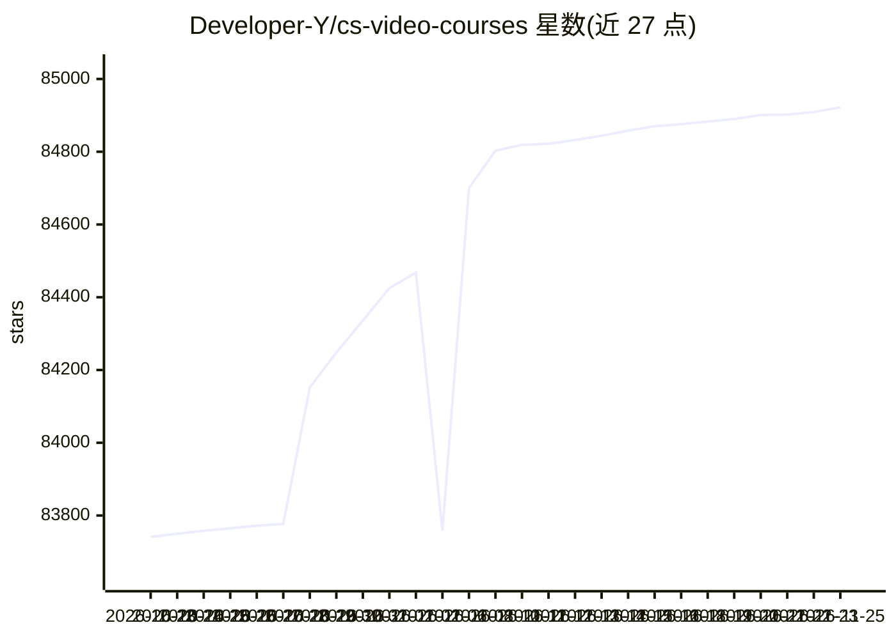

# Developer-Y/cs-video-courses

⭐ 84,922 · 推送 2026-11-20 · [GitHub](https://github.com/Developer-Y/cs-video-courses) · 个人维护

**计算机科学公开课视频清单：按学科整理大学课程链接**

以清单形式收录大学级别的计算机科学课程及视频讲座链接，按计算机入门、数据结构与算法、系统编程等学科分类组织，条目标注学校、学期与视频来源（YouTube/Bilibili/OCW 等）。收录标准排除小型 MOOC、基础教程与广告链接，仅接受真实大学课程，通过 issue 与 PR 接受社区贡献，维护者会屏蔽灌水账号。

## 筛选速览

| 维度 | 判定 | 备注 |
|---|---|---|
| AI 角色 | `ai-knowledge` | 知识聚合/清单类 |
| 许可风险 | `none` | — |
| 部署形态 | `None` |  |
| 模型依赖 | — | README 未给出锁定关系 |
| 硬件要求 | — | 无带数字的原话,不猜 |
| 安装摩擦 | `medium` | 含编译或系统依赖之一 |
| 成熟度 | — | 结构信号不足 |

## 动量与使用信号

- 维护:`active` — 距上次 push 3.8 天,年发版 0,117 位贡献者
- 涨星:近 1 天 **+9**(自 20261016 起算)
- 安装:github 包 `release-assets` 月下载无数据

## 能力要点

- 按学科分类组织课程条目（入门、算法、系统编程等）
- 条目标注学校、授课教师、学期与视频来源
- 仅收录大学级别课程，排除 MOOC 与广告链接
- 支持社区通过 PR 贡献新课程条目

## 适用场景

- 查找某门算法或系统课程的公开视频讲座
- 自学时按学科挑选大学公开课
- 为课程学习补充多个学校的教学资源

## 场景标签

`精选清单` · 领域:学习与行业

## 证据(README 行号)

> L1: # Computer Science courses with video lectures
> L14: ## Courses
> L16: ### Introduction to Computer Science

## 星数曲线

2026-10-23 83,741 → 2026-11-25 84,922（+1,181）

---
*卡片 v1 · prompt 1.4 · 生成 2026-11-22 · 置信度 high · 依据 README sha `ad578ae14626` · [字段定义](../../DATASET.md)*
