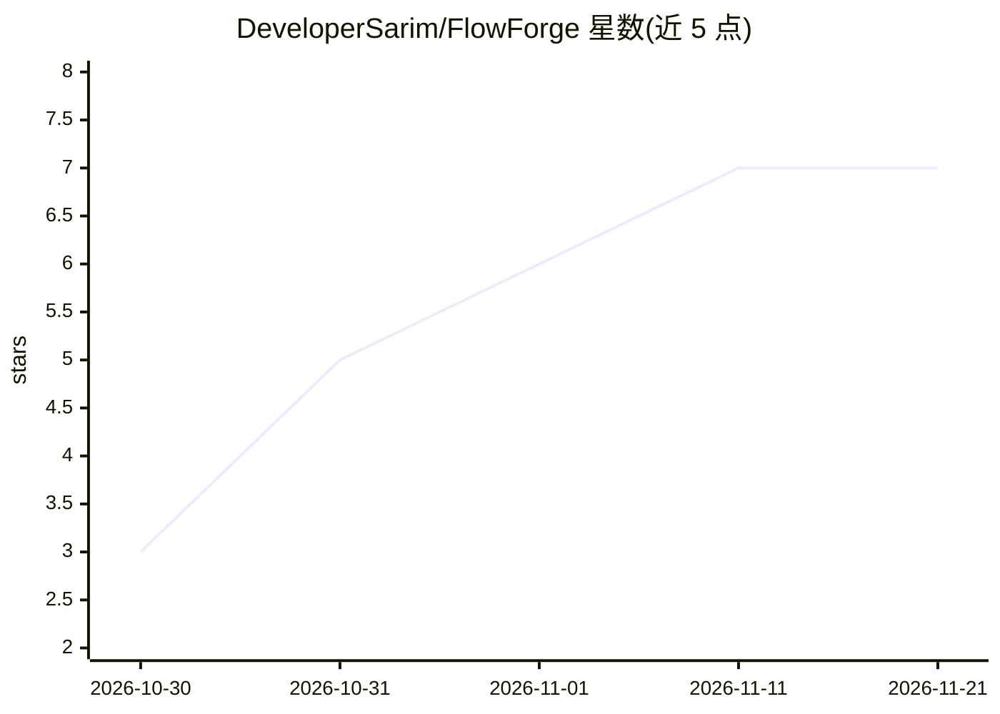

# DeveloperSarim/FlowForge

⭐ 7 · PHP · AGPL-3.0 · 推送 2026-10-18 · [GitHub](https://github.com/DeveloperSarim/FlowForge) · [官网](https://developersarim.github.io/FlowForge/) · 个人维护

**PHP 共享主机上的自托管工作流自动化与 AI 语音代理平台**

面向已有普通网页主机（Hostinger、cPanel、DirectAdmin、VPS）的用户，提供可在 PHP 8.2 + MySQL 环境运行的自托管自动化服务器：可视化画布连接 1,690 个应用，AI Builder 从一句话生成工作流并可用任意模型 key，AI 语音代理可接听电话并预约。无需 Docker、Node.js 或 SSH，靠每分钟一个 cron 任务驱动；AGPL-3.0 许可，无按任务计费。提供安装向导、一键更新与回滚。

## 筛选速览

| 维度 | 判定 | 备注 |
|---|---|---|
| AI 角色 | `ai-enhanced` | 去掉 AI 部分产品仍成立 |
| 许可风险 | `viral` | AGPL-3.0 |
| 部署形态 | `desktop` | 安装包/桌面程序 |
| 模型依赖 | local-ok | 支持本地模型 |
| 硬件要求 | — | 无带数字的原话,不猜 |
| 安装摩擦 | `low` | 无编译、无系统依赖或容器化 |
| 成熟度 | — | 结构信号不足 |

## 能力要点

- 1,690 个应用、8,700 个动作、800 个触发器与 54 个模板的可视化工作流
- AI Builder 从自然语言生成工作流，支持任意 OpenAI/Anthropic 兼容 API 作为自定义 provider
- AI 语音代理：12 个现成代理、浏览器免费测试通话、经 Vapi 或 ElevenLabs 实际通话
- MCP 服务器：Claude Code、Cursor、VS Code 代理可搜索并构建、测试、运行工作流

## 适用场景

- 在共享主机上自托管自动化服务器，连接 Gmail/Slack/Shopify 等应用
- 用一句话让 AI 生成多步骤工作流
- 搭建接听电话并预约的 AI 前台或回访代理
- 通过 MCP 让编码代理操作工作流

## 场景标签

`工作流自动化` `语音 Agent` · 领域:效率与自动化

## 证据(README 行号)

> L6:  A self-hosted alternative to n8n, Zapier and Make: connect 1,690 apps on a visual canvas, let AI build workflows fr
> L31: FlowForge is a **self-hosted workflow automation platform** for people who already have ordinary web hosting. Uploa
> L38: - **Any AI model.** OpenAI, Claude, Gemini, DeepSeek, Qwen, or any OpenAI- or Anthropic-compatible API (OpenRouter,

## 星数曲线

2026-10-30 3 → 2026-11-21 7（+4）

---
*卡片 v1 · prompt 1.4 · 生成 2026-11-20 · 置信度 mid · 依据 README sha `2826d2e55819` · [字段定义](../../DATASET.md)*
