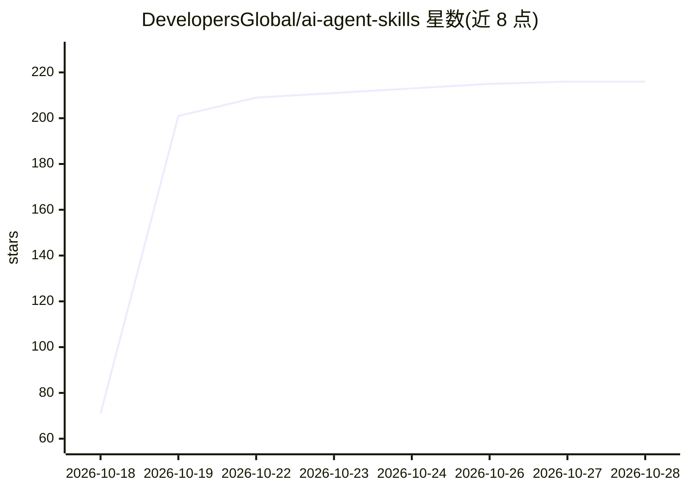

# DevelopersGlobal/ai-agent-skills

⭐ 216 · Python · MIT · 推送 2026-10-28 · [GitHub](https://github.com/DevelopersGlobal/ai-agent-skills) · [官网](https://developersglobal.github.io/ai-agent-skills/) · 组织维护

**面向 AI 编程代理的 30 个生产级技能（SKILL.md）策展库**

收录 30 个结构化 markdown 技能文件的清单库，覆盖思考规划、任务分解、编码、测试、代码审查、安全加固（OWASP、提示注入防御、幻觉防范）与部署等 7 个阶段，另含 3 个日常生产力技能。技能以复制粘贴方式接入 Claude、Cursor、Copilot、Gemini CLI 等代理的系统提示或规则文件，提供 GitHub Pages 浏览器（全文搜索、分类过滤、一键复制）。灵感来自 addyosmani/agent-skills 与 karpathy-skills 两个仓库。

## 筛选速览

| 维度 | 判定 | 备注 |
|---|---|---|
| AI 角色 | `ai-knowledge` | 知识聚合/清单类 |
| 许可风险 | `permissive` | MIT |
| 部署形态 | `None` |  |
| 模型依赖 | — | README 未给出锁定关系 |
| 硬件要求 | — | 无带数字的原话,不猜 |
| 安装摩擦 | `low` | 无编译、无系统依赖或容器化 |
| 成熟度 | — | 结构信号不足 |

## 能力要点

- 30 个技能按 THINK→PLAN→BUILD→TEST→REVIEW→HARDEN→SHIP 流程组织
- 含提示注入防御、幻觉防范、AI 输出校验、多代理编排等 AI 安全类技能
- 提供 GitHub Pages 技能浏览器：全文搜索、分类过滤、一键复制
- 技能可通过复制到 CLAUDE.md / .cursor/rules / GEMINI.md 等方式接入各代理

## 适用场景

- 为我的 Claude Code / Cursor / Copilot 代理补充工程纪律与安全规范
- 查找防止 LLM 幻觉与提示注入攻击的现成技能
- 按类别浏览并复制生产部署、测试驱动开发等技能

## 场景标签

`提示工程` `精选清单` · 领域:Agent 开发

## 证据(README 行号)

> L17: AI agents are only as good as the instructions they follow. **AI Agent Skills** is a curated, battle-tested library
> L76: ## 📚 All 30 Skills

## 星数曲线

2026-10-18 71 → 2026-10-28 216（+145）

---
*卡片 v1 · prompt 1.4 · 生成 2026-10-22 · 置信度 high · 依据 README sha `2de0079470c5` · [字段定义](../../DATASET.md)*
